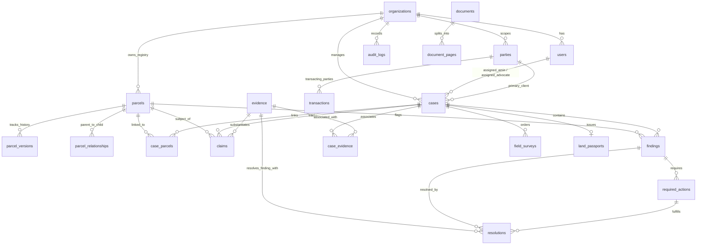

# BHUMISETU — PHASE 2 DATABASE REFERENCE
**Document Code:** BS-DB-REF-V1.1  
**Engine:** PostgreSQL 16 + PostGIS 3.4 (with cross-compatible SQLite WKT abstraction for headless CI/CD)  
**ORM:** SQLAlchemy 2.0  
**Migration Manager:** Alembic (Revision: `56683e40f899_initial_mvp_schema`)  
**Status:** IMPLEMENTED & PRODUCTION READY  

---

## 1. Architectural Overview

The BhumiSetu database is structured as a **strictly typed, relational domain model** designed to maintain epistemic humility, temporal auditability, and absolute multi-tenant data isolation.

### Key Architectural Mandates Enforced:
1. **Primary Keys:** Every domain entity uses a universally unique identifier (`UUIDv4`), stored as native `UUID` on PostgreSQL and cross-compatible 36-character `GUID` on SQLite.
2. **Tenant Scoping:** All core data objects (`parcels`, `cases`, `users`, `audit_logs`) explicitly declare an `org_id` foreign key referencing `organizations(org_id) ON DELETE CASCADE`.
3. **Immutability of Source Truth:** Documents and audit logs are append-only. No physical deletion or overwrite of registered evidence is permitted.
4. **Epistemic Separation:** Claims, Evidence, and Ground Truth are decoupled. Conflicting or competing claims coexist on the same parcel.
5. **Spatial Geometry:** Stored with explicit SRID (`EPSG:4326`) via `CompatibleGeometry` abstraction, ensuring zero lock-in while leveraging native spatial indexing on PostgreSQL.

---

## 2. Entity-Relationship Schema (23 Tables)



---

## 3. Table Catalog & Detailed DDL Specifications

### 3.1 Organization & Identity

#### `organizations` (Tenant Partition)
| Column | Type | Constraints | Description |
| :--- | :--- | :--- | :--- |
| `org_id` | UUID | PRIMARY KEY | Unique Organization UUID |
| `name` | VARCHAR(128) | NOT NULL | Tenant entity legal name |
| `slug` | VARCHAR(64) | UNIQUE, NOT NULL, INDEX | URL identifier (e.g. `deoghar-ops`) |
| `created_at` | TIMESTAMPTZ | NOT NULL | Record creation timestamp |

#### `users` (System Operators & Professionals)
| Column | Type | Constraints | Description |
| :--- | :--- | :--- | :--- |
| `user_id` | UUID | PRIMARY KEY | Unique User UUID |
| `org_id` | UUID | FK(organizations.org_id, CASCADE), INDEX | Tenant scope |
| `full_name` | VARCHAR(128) | NOT NULL | Operator legal name |
| `email` | VARCHAR(128) | UNIQUE, NOT NULL, INDEX | Login email address |
| `hashed_password` | VARCHAR(256) | NOT NULL | Bcrypt salted hash |
| `phone_number` | VARCHAR(20) | NOT NULL | Phone contact |
| `role` | VARCHAR(32) | NOT NULL | `ADMIN`, `CASE_OPERATOR`, `FIELD_EXPERT`, `LEGAL_REVIEWER`, `REVIEWER` |
| `is_active` | BOOLEAN | NOT NULL, DEFAULT TRUE | User active flag |
| `created_at` | TIMESTAMPTZ | NOT NULL | Account creation timestamp |

#### `parties` (Landowners, Buyers, Vendors, Legal Entities)
| Column | Type | Constraints | Description |
| :--- | :--- | :--- | :--- |
| `party_id` | UUID | PRIMARY KEY | Unique Party UUID |
| `org_id` | UUID | FK(organizations.org_id, CASCADE), INDEX | Tenant scope |
| `party_type` | VARCHAR(32) | NOT NULL | `PERSON`, `ORGANIZATION`, `GOVERNMENT_ENTITY`, `TRUST`, `HUF`, `OTHER` |
| `primary_name` | VARCHAR(128) | NOT NULL | Stated or recorded legal name |
| `canonical_transliterated_name`| VARCHAR(128) | INDEX | Standardized transliteration |
| `father_or_husband_name` | VARCHAR(128) | INDEX | Parentage identifier (critical for khatiyan cross-referencing) |
| `relationship_type` | VARCHAR(16) | DEFAULT 'SON_OF' | `SON_OF`, `DAUGHTER_OF`, `WIFE_OF`, `REPRESENTED_BY` |
| `community_caste_category` | VARCHAR(32) | NOT NULL, DEFAULT 'GENERAL' | `GENERAL`, `OBC`, `SC`, `ST` (Mandatory for SPT Sec 20 / CNT Sec 46) |
| `is_tribal` | BOOLEAN | NOT NULL, DEFAULT FALSE | Tribal protection flag |
| `phone_number` | VARCHAR(20) | NULL | Optional contact |
| `residence_village_lgd` | VARCHAR(32) | NULL | LGD Village Code of residence |
| `created_at` | TIMESTAMPTZ | NOT NULL | Timestamp |

---

### 3.2 Land & Cadastral Hierarchy

#### `parcels` (Enduring Land Object)
*Note: `current_owner` is NEVER stored on this table as canonical truth.*
| Column | Type | Constraints | Description |
| :--- | :--- | :--- | :--- |
| `parcel_id` | UUID | PRIMARY KEY | Unique Parcel UUID |
| `org_id` | UUID | FK(organizations.org_id, CASCADE), INDEX | Tenant scope |
| `bhumi_id` | VARCHAR(64) | UNIQUE, NOT NULL, INDEX | Natural standardized ID (e.g. `JH-DEO-364000-542-XXXX`) |
| `state_code` | VARCHAR(4) | NOT NULL | 2-letter state code (`JH`, `BR`, `UP`) |
| `district_name` | VARCHAR(64) | NOT NULL | District name (e.g. `Deoghar`) |
| `subdistrict_anchal_name` | VARCHAR(64) | NOT NULL | Revenue circle / Anchal (e.g. `Mohanpur`) |
| `halka_number` | VARCHAR(16) | NULL | Revenue halka identifier |
| `mauza_village_name` | VARCHAR(128) | NOT NULL | Mauza revenue village name |
| `census_village_code` | VARCHAR(32) | NOT NULL, INDEX | Census / LGD Village Code |
| `khata_number` | VARCHAR(32) | NOT NULL | Revenue holding / Khata number |
| `plot_khesra_number` | VARCHAR(32) | NOT NULL | Cadastral plot / Khesra number |
| `subdivision_hissa_number` | VARCHAR(32) | NULL | Sub-share / hissa identifier |
| `recorded_area_acres` | NUMERIC(10,4) | NOT NULL | Officially recorded extent in acres |
| `land_nature` | VARCHAR(32) | NOT NULL, DEFAULT 'AGRICULTURAL_RAIYATI' | Revenue classification |
| `centroid_point` | GEOMETRY(POINT, 4326) | NULL | Geo centroid coordinate |
| `authoritative_boundary` | GEOMETRY(MULTIPOLYGON, 4326) | NULL | Verified GIS polygon boundary |
| `created_at` | TIMESTAMPTZ | NOT NULL | Creation timestamp |
| `updated_at` | TIMESTAMPTZ | NOT NULL | Last update timestamp |

#### `parcel_versions` (Historical Extent & Boundary Evolution)
| Column | Type | Constraints | Description |
| :--- | :--- | :--- | :--- |
| `version_id` | UUID | PRIMARY KEY | Unique version identifier |
| `parcel_id` | UUID | FK(parcels.parcel_id, CASCADE), INDEX | Target parcel |
| `version_number` | INTEGER | NOT NULL | Monotonically increasing version index |
| `recorded_area_acres`| NUMERIC(10,4) | NOT NULL | Area at this version |
| `boundary_geometry` | GEOMETRY(MULTIPOLYGON, 4326) | NULL | Boundary snapshot |
| `change_reason` | VARCHAR(256) | NOT NULL | Cause of revision (e.g. `RE_SURVEY_1985`) |
| `created_at` | TIMESTAMPTZ | NOT NULL | Snapshot timestamp |

#### `parcel_relationships` (Cadastral Lineage & Transformations)
| Column | Type | Constraints | Description |
| :--- | :--- | :--- | :--- |
| `relationship_id` | UUID | PRIMARY KEY | Unique relationship identifier |
| `parent_parcel_id` | UUID | FK(parcels.parcel_id, CASCADE), INDEX | Predecessor parcel |
| `child_parcel_id` | UUID | FK(parcels.parcel_id, CASCADE), INDEX | Successor parcel |
| `relationship_type` | VARCHAR(32) | NOT NULL | `SUBDIVIDED_TO`, `MERGED_TO`, `RENUMBERED_TO`, `CORRECTED_TO` |
| `effective_date` | DATE | NOT NULL | Legal/revenue effective date |
| `mutation_order_reference` | VARCHAR(128) | NULL | Official Dakhil Kharij case number |
| `created_at` | TIMESTAMPTZ | NOT NULL | Record creation timestamp |

---

### 3.3 Verification Workflow & Evidence Vault

#### `cases` (Verification Life Cycle State Machine)
| Column | Type | Constraints | Description |
| :--- | :--- | :--- | :--- |
| `case_id` | UUID | PRIMARY KEY | Unique Case UUID |
| `org_id` | UUID | FK(organizations.org_id, CASCADE), INDEX | Tenant scope |
| `case_number` | VARCHAR(32) | UNIQUE, NOT NULL, INDEX | Human-readable case tracking number |
| `primary_client_party_id` | UUID | FK(parties.party_id), NOT NULL | Customer / Client party |
| `assigned_amin_id` | UUID | FK(users.user_id), NULL | Assigned field surveyor |
| `assigned_advocate_id` | UUID | FK(users.user_id), NULL | Assigned legal reviewer |
| `status` | VARCHAR(32) | NOT NULL, INDEX | State machine state (`DRAFT` to `FINAL`) |
| `transaction_readiness_state` | VARCHAR(32) | NOT NULL | `NOT_READY`, `REQUIRES_CONDITIONAL_RESOLUTION`, `BLOCKED_STATUTORY_HAZARD`, `READY_FOR_LEGAL_CLOSING` |
| `target_transaction_id` | UUID | FK(transactions.transaction_id), NULL | Independent linked transaction |
| `created_at` | TIMESTAMPTZ | NOT NULL | Creation timestamp |
| `updated_at` | TIMESTAMPTZ | NOT NULL | Last update timestamp |

#### `evidence` (Reusable Epistemic Vault Artifact)
*Evidence does not fundamentally belong to one case; it can be cross-referenced across multiple cases.*
| Column | Type | Constraints | Description |
| :--- | :--- | :--- | :--- |
| `evidence_id` | UUID | PRIMARY KEY | Unique Evidence UUID |
| `evidence_type` | VARCHAR(32) | NOT NULL | `GOVERNMENT_RECORD`, `REGISTERED_DOCUMENT`, `USER_DOCUMENT`, `MAP`, `GIS_RECORD`, `FIELD_PHOTO`, `GPS_OBSERVATION`, `EXPERT_OBSERVATION`, `LEGAL_REVIEW`, `AI_DERIVATION` |
| `authority_tier` | VARCHAR(32) | NOT NULL | `STATUTORY_REGISTRY`, `REVENUE_RECORD`, `FIELD_OBSERVATION`, `USER_SUBMISSION`, `AI_DERIVED` |
| `source_name` | VARCHAR(128) | NOT NULL | Human-readable source descriptor |
| `storage_uri` | VARCHAR(512) | NOT NULL | Secure storage pointer |
| `sha256_hash` | VARCHAR(64) | NOT NULL, INDEX | Cryptographic integrity hash |
| `captured_by_party_id` | UUID | FK(parties.party_id), NULL | Submitter / Surveyor |
| `captured_at` | TIMESTAMPTZ | NOT NULL | When observed / fetched |
| `evidence_metadata` | JSONB | NOT NULL | Typed extraction attributes |
| `created_at` | TIMESTAMPTZ | NOT NULL | Ingestion timestamp |

#### `case_evidence` (Association Junction)
| Column | Type | Constraints | Description |
| :--- | :--- | :--- | :--- |
| `case_id` | UUID | FK(cases.case_id, CASCADE), PRIMARY KEY | Associated Case |
| `evidence_id` | UUID | FK(evidence.evidence_id, CASCADE), PRIMARY KEY | Associated Evidence |
| `attached_at` | TIMESTAMPTZ | NOT NULL | Association timestamp |

#### `documents` (Immutable Raw Physical Files)
| Column | Type | Constraints | Description |
| :--- | :--- | :--- | :--- |
| `document_id` | UUID | PRIMARY KEY | Unique Document UUID |
| `original_filename` | VARCHAR(256) | NOT NULL | Client provided filename |
| `mime_type` | VARCHAR(64) | NOT NULL | MIME content type |
| `file_size_bytes` | INTEGER | NOT NULL | File size in bytes |
| `storage_uri` | VARCHAR(512) | NOT NULL | Path on disk / S3 bucket |
| `sha256_hash` | VARCHAR(64) | NOT NULL, INDEX | Content hash |
| `uploader_party_id` | UUID | FK(parties.party_id), NULL | Uploader identity |
| `processing_status` | VARCHAR(32) | NOT NULL | `UPLOADED`, `PROCESSING`, `PROCESSED`, `FAILED`, `NOT_PROCESSED` |
| `created_at` | TIMESTAMPTZ | NOT NULL | Upload timestamp |

---

### 3.4 Atomic Claims & Epistemic Reasoning

#### `claims` (Atomic Subject-Predicate-Object Assertions)
*Competing claims coexist simultaneously without data clobbering.*
| Column | Type | Constraints | Description |
| :--- | :--- | :--- | :--- |
| `claim_id` | UUID | PRIMARY KEY | Unique Claim UUID |
| `case_id` | UUID | FK(cases.case_id, CASCADE), NOT NULL, INDEX | Enclosing verification case |
| `parcel_id` | UUID | FK(parcels.parcel_id, CASCADE), NOT NULL, INDEX | Target parcel |
| `evidence_id` | UUID | FK(evidence.evidence_id, CASCADE), NOT NULL, INDEX | Direct supporting evidence |
| `subject_entity_type` | VARCHAR(32) | NOT NULL | `PARCEL`, `PARTY` |
| `subject_id` | UUID | NOT NULL, INDEX | ID of subject entity |
| `predicate` | VARCHAR(64) | NOT NULL, INDEX | `RECORDED_OWNER`, `RECORDED_AREA`, `BOUNDARY_NORTH`, `MUTATION_STATUS`, `LIEN_STATUS`, `POSSESSION_HOLDER` |
| `object_value` | JSONB | NOT NULL | Asserted value structure |
| `authority_tier` | VARCHAR(32) | NOT NULL | Authority tier of underlying source |
| `confidence_score` | NUMERIC(5,2) | NOT NULL, DEFAULT 1.0 | Extraction confidence (0.0 to 1.0) |
| `observed_at` | TIMESTAMPTZ | NOT NULL | Observation timestamp |
| `recorded_at` | TIMESTAMPTZ | NULL | Date recorded in original ledger |
| `effective_from` | DATE | NULL | Legal validity start date |
| `effective_to` | DATE | NULL | Legal validity end date (if superseded) |
| `status` | VARCHAR(32) | NOT NULL, INDEX | `ACTIVE`, `SUPERSEDED`, `DISPUTED`, `REJECTED`, `UNVERIFIED`, `CONFLICTING` |
| `created_at` | TIMESTAMPTZ | NOT NULL | Creation timestamp |

---

### 3.5 Findings, Actions, Resolutions & Auditing

#### `findings` (Deterministic Discrepancies & Statutory Hazards)
| Column | Type | Constraints | Description |
| :--- | :--- | :--- | :--- |
| `finding_id` | UUID | PRIMARY KEY | Unique Finding UUID |
| `case_id` | UUID | FK(cases.case_id, CASCADE), NOT NULL, INDEX | Associated Case |
| `parcel_id` | UUID | FK(parcels.parcel_id, CASCADE), NOT NULL, INDEX | Target Parcel |
| `rule_id` | VARCHAR(64) | NOT NULL, INDEX | Versioned rule ID (e.g. `LEGAL_RULE_JH_SPT_SEC_20`, `RULE_AREA_DELTA_CHECK`) |
| `severity` | VARCHAR(16) | NOT NULL | `CRITICAL`, `HIGH`, `MEDIUM`, `LOW`, `INFORMATIONAL` |
| `status` | VARCHAR(32) | NOT NULL, INDEX | `OPEN`, `IN_PROGRESS`, `BLOCKED`, `RESOLVED`, `ACCEPTED_WITH_REVIEW`, `WONT_RESOLVE` |
| `observed_values` | JSONB | NOT NULL | Concrete telemetry triggering the rule |
| `explanation` | TEXT | NOT NULL | Human and legal explanation |
| `recommended_action`| TEXT | NULL | Prescribed remediation task |
| `created_at` | TIMESTAMPTZ | NOT NULL | Timestamp |

#### `required_actions` (Operational Remediation Tasks)
| Column | Type | Constraints | Description |
| :--- | :--- | :--- | :--- |
| `action_id` | UUID | PRIMARY KEY | Unique Action UUID |
| `finding_id` | UUID | FK(findings.finding_id, CASCADE), NOT NULL, INDEX | Parent finding |
| `case_id` | UUID | FK(cases.case_id, CASCADE), NOT NULL, INDEX | Enclosing case |
| `action_type` | VARCHAR(64) | NOT NULL | Operational type (e.g. `FIELD_DEMARCATION_SURVEY`, `STATUTORY_CLEARANCE_INSPECTION`) |
| `assigned_role` | VARCHAR(32) | NOT NULL | `FIELD_AMIN`, `LEGAL_ADVOCATE`, `OPERATIONS_DESK` |
| `assigned_to_party_id`| UUID | FK(parties.party_id), NULL | Assigned specific user/party |
| `status` | VARCHAR(32) | NOT NULL, INDEX | `OPEN`, `IN_PROGRESS`, `BLOCKED`, `COMPLETED`, `CANCELLED` |
| `resolution_notes` | TEXT | NULL | Remediation report notes |
| `resolved_by_party_id`| UUID | FK(parties.party_id), NULL | Party signing off |
| `resolving_evidence_id`| UUID | FK(evidence.evidence_id), NULL | Evidence proving remediation |
| `resolved_at` | TIMESTAMPTZ | NULL | Completion timestamp |
| `created_at` | TIMESTAMPTZ | NOT NULL | Creation timestamp |

#### `resolutions` (Verified Evidentiary Sign-Off)
| Column | Type | Constraints | Description |
| :--- | :--- | :--- | :--- |
| `resolution_id` | UUID | PRIMARY KEY | Unique Resolution UUID |
| `finding_id` | UUID | FK(findings.finding_id, CASCADE), NOT NULL, INDEX | Finding resolved |
| `action_id` | UUID | FK(required_actions.action_id, CASCADE), NOT NULL, INDEX | Fulfilling action |
| `resolving_evidence_id`| UUID | FK(evidence.evidence_id), NOT NULL | Mandatory evidence proof |
| `reviewer_party_id` | UUID | FK(parties.party_id), NOT NULL | Signing reviewer |
| `resolution_outcome`| VARCHAR(64) | NOT NULL | Outcome code |
| `notes` | TEXT | NULL | Detailed rationale |
| `resolved_at` | TIMESTAMPTZ | NOT NULL | Timestamp |

#### `audit_logs` (Append-Only Cryptographic Audit Trail)
| Column | Type | Constraints | Description |
| :--- | :--- | :--- | :--- |
| `log_id` | UUID | PRIMARY KEY | Unique Log UUID |
| `org_id` | UUID | FK(organizations.org_id, CASCADE), NOT NULL, INDEX | Tenant scope |
| `actor_party_id` | UUID | FK(parties.party_id, SET NULL), NULL, INDEX | Who performed the action |
| `action` | VARCHAR(64) | NOT NULL, INDEX | Action descriptor (e.g. `CASE_STATUS_TRANSITION`) |
| `entity_name` | VARCHAR(32) | NOT NULL, INDEX | Entity type mutated (`CASE`, `FINDING`, `RESOLUTION`) |
| `entity_id` | UUID | NOT NULL, INDEX | Primary key of mutated entity |
| `previous_state` | JSONB | NULL | Before state snapshot |
| `new_state` | JSONB | NULL | After state snapshot |
| `ip_address` | VARCHAR(45) | NULL | Client IP |
| `created_at` | TIMESTAMPTZ | NOT NULL, INDEX | Timestamp |

---

## 4. Migration Execution & Reproducibility

The complete schema is version-controlled via Alembic:
- Migration Script: `backend/alembic/versions/56683e40f899_initial_mvp_schema.py`
- Command to migrate fresh database:
  ```bash
  alembic upgrade head
  ```
- Command to seed demo environment:
  ```bash
  python -m app.seed.demo_seed
  ```
