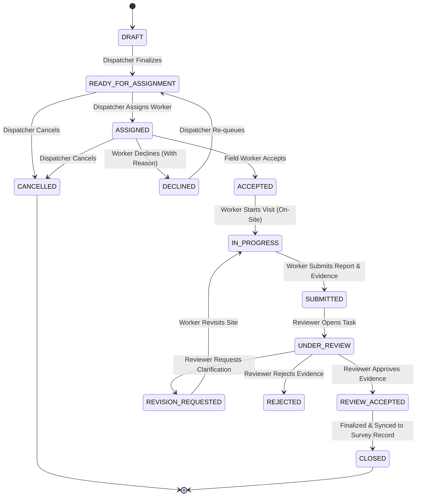

# Engineering Implementation Note: TASK-P1-04 LandAmin Field Task Dispatcher & Mobile API

**Component:** `backend/app/services/amin_service.py`, `backend/app/routers/landamin.py`, `backend/app/models/field_task.py`, `backend/app/schemas/field_task.py`  
**Status:** Completed & Tested (96/96 Tests Passing)  
**Date:** October 2026  
**Parent Roadmap Milestone:** Phase 1 — Ground Verification & Land Intelligence Dispatch

---

## 1. Initial Repository Audit

A comprehensive pre-implementation audit was conducted across the Bhumi Setu backend:
1. **Existing Models:**
   - `backend/app/models/field_survey.py`: Contained table `field_surveys` storing `measured_area_acres`, `measured_boundary_geometry` (SRID=4326), `north_ground_neighbor` through `west_ground_neighbor`, `road_access_type`, `road_frontage_feet`, and `physical_possessor_name`.
   - `backend/app/models/case.py`: Included `assigned_amin_id` (foreign key to `users.user_id`) and `CaseStatus.FIELD_VERIFICATION`.
   - `backend/app/models/finding.py`: Included `RequiredAction` with `assigned_role="FIELD_AMIN"` and resolution workflow via `Resolution`.
   - `backend/app/models/user.py`: Defined `UserRole.FIELD_EXPERT` representing field Amins.
   - `backend/app/models/evidence.py`: Defined `EvidenceType.FIELD_PHOTO`, `EvidenceType.GPS_OBSERVATION`, and `AuthorityTier.FIELD_OBSERVATION`.
2. **Architecture Gap Identified:**
   - Although `field_surveys` existed as a finalized survey record, there was no intermediate workflow entity representing the dispatchable field-verification task, assignment tracking, rejection/decline reasons, mobile draft observation ingestion, or reviewer sign-off state machine.
   - Dispatchers had no dedicated endpoints to list eligible Amins or assign tasks.
   - Field Amins had no mobile endpoints to fetch assigned tasks, accept/decline, start visits, upload georeferenced photo evidence with SHA-256 integrity, or submit structured observations.
3. **Integration Alignment:**
   - Designed `FieldVerificationTask` as the operational dispatch entity linking cases, parcels, and originating discrepancies (from P1-01 Jamabandi, P1-02 Bhu-Naksha, or P1-03 OCR document cross-referencing).
   - Ensured zero destructive schema modifications and zero regressions on existing test suites.

---

## 2. Epistemic Principles & Legal Boundaries

1. **Non-Authoritative Demarcation Principle:**
   - A field observation collected by a field worker (even with high-end smartphone GNSS) is **indicative supporting evidence only**.
   - It **never automatically becomes a legally authoritative boundary, statutory revenue record, or court-decreed title determination**.
2. **Authoritative Cadastral Geometry Protection:**
   - Existing authoritative cadastral geometry (`Parcel.authoritative_boundary` from Bhu-Naksha) is **never overwritten** automatically by field observations.
   - Spatial comparisons compute deltas and record review findings while preserving both the original cadastral polygon and the field observation separately.
3. **Accuracy Transparency:**
   - Smartphone and field GNSS readings report horizontal accuracy (e.g., ±3.5 meters).
   - System strictly prohibits false claims of certified Electronic Total Station (ETS) or Differential GPS (DGPS) survey grade unless verified hardware and calibration certificates are presented.

---

## 3. Architecture & Core Workflow



### Stage A — Request Creation
- Originates from cadastral vs. revenue area discrepancies (P1-02), Chauhaddi mismatches (P1-03), plot conflicts, or manual inspection needs.
- References `case_id`, optional `parcel_id`, `finding_id`, and `action_id`.
- Captures title, priority (`CRITICAL`, `HIGH`, `MEDIUM`, `LOW`), requested activities, due dates, and special instructions.

### Stage B — Assignment
- Dispatcher inspects eligible field workers in the same organization.
- Explicitly distinguishes registered field personnel from workers whose state credentials have been independently verified.
- Sets service window, instructions, and reference documents.
- Disallows worker self-assignment unless permitted by role.

### Stage C — Field-Worker Acceptance
- Worker accesses `/api/v1/landamin/mobile/my-tasks`.
- Reviews task instructions, location, and reference documents.
- Accepts or declines assignment with recorded reason (e.g. site inaccessible).

### Stage D — Field Visit & Evidence Collection
- Worker marks visit start (`POST /mobile/tasks/{id}/start-visit`), recording timestamp and location.
- Captures GNSS corner points, boundary traverse points, and reported accuracy.
- Records ground Chauhaddi occupants (North, South, East, West).
- Records physical possessor details, road access type (`PUCCA_ROAD`, `KACHA_RASTA`, `PATHWAY`, `LANDLOCKED`), and frontage.
- Uploads georeferenced photo evidence (verified magic byte signatures, SHA-256 hash, stored in `DocumentStorage`).
- Submits structured narrative report.

---

## 4. Models & Database Changes

### Model: `FieldVerificationTask` (`app/models/field_task.py`)
- `task_id` (UUID, PK)
- `org_id` (UUID, FK `organizations.org_id`, indexed) — strict tenant isolation.
- `case_id` (UUID, FK `cases.case_id`, indexed)
- `parcel_id` (UUID, FK `parcels.parcel_id`, nullable)
- `finding_id` (UUID, FK `findings.finding_id`, nullable)
- `action_id` (UUID, FK `required_actions.action_id`, nullable)
- `survey_id` (UUID, FK `field_surveys.survey_id`, nullable)
- `task_number` (String(32), unique, e.g. `FT-20261024-XXXX`)
- `title` (String(256))
- `reason` (Text)
- `requested_activities` (JSONCompatible list)
- `priority` (String(16))
- `status` (String(32), indexed)
- `assigned_amin_id` (UUID, FK `users.user_id`, indexed)
- `assigned_by_user_id` (UUID, FK `users.user_id`)
- `reviewer_user_id` (UUID, FK `users.user_id`)
- `assigned_at`, `due_date`, `instructions`, `decline_reason`, `cancellation_reason`
- `visit_started_at`, `visit_completed_at`
- `field_observations` (JSONCompatible dict: GPS points, boundary points, calculated area, ground neighbors, possessor, road access)
- `evidence_ids` (JSONCompatible list of UUIDs)
- `review_status`, `review_notes`, `reviewed_at`
- `created_at`, `updated_at`

### Database Migration
- Alembic migration `backend/alembic/versions/a1b2c3d4e5f6_add_field_verification_tasks.py` created with `upgrade()` and `downgrade()`.

---

## 5. API Endpoints

### Dispatcher Endpoints (`/api/v1/landamin/`)
| Method | Endpoint | Authorized Roles | Description |
|---|---|---|---|
| `POST` | `/tasks` | `ADMIN`, `CASE_OPERATOR` | Create field-verification task |
| `GET` | `/tasks` | Authenticated | List tasks with filters (`status`, `priority`, `case_id`) |
| `GET` | `/tasks/{id}` | Authenticated | Retrieve task detail with spatial comparison |
| `POST` | `/tasks/{id}/assign` | `ADMIN`, `CASE_OPERATOR` | Assign or reassign worker with audit log |
| `POST` | `/tasks/{id}/cancel` | `ADMIN`, `CASE_OPERATOR` | Cancel task with recorded reason |
| `POST` | `/tasks/{id}/review` | `LEGAL_REVIEWER`, `REVIEWER`, `ADMIN` | Accept, reject, or request revision on report |
| `GET` | `/workers/eligible` | `ADMIN`, `CASE_OPERATOR` | List eligible Amins in tenant |

### Mobile Field Worker Endpoints (`/api/v1/landamin/mobile/`)
| Method | Endpoint | Authorized Roles | Description |
|---|---|---|---|
| `GET` | `/my-tasks` | `FIELD_EXPERT`, `ADMIN` | List tasks assigned to caller |
| `GET` | `/tasks/{id}` | `FIELD_EXPERT`, `ADMIN` | Retrieve assigned task detail |
| `POST` | `/tasks/{id}/accept` | `FIELD_EXPERT`, `ADMIN` | Accept assigned task |
| `POST` | `/tasks/{id}/decline` | `FIELD_EXPERT`, `ADMIN` | Decline assigned task with reason |
| `POST` | `/tasks/{id}/start-visit`| `FIELD_EXPERT`, `ADMIN` | Record visit commencement |
| `POST` | `/tasks/{id}/photos` | `FIELD_EXPERT`, `ADMIN` | Upload georeferenced photo evidence |
| `POST` | `/tasks/{id}/submit` | `FIELD_EXPERT`, `ADMIN` | Submit field report and observations |

---

## 6. Geospatial Coordinate Handling & Boundary Math

1. **Validation & CRS:**
   - Coordinates validated within WGS84 bounds (latitude [-90, 90], longitude [-180, 180]).
   - Explicit CRS declaration required (`EPSG:4326`, `EPSG:32645`); unknown CRS rejected.
   - Positional accuracy recorded in meters and verified non-negative.
2. **Polygon Area Calculation:**
   - Implemented `calculate_polygon_area_acres()` using local planar metric conversion around average latitude ($\approx 25.5^\circ\text{N}$ in Bihar):
     $$1^\circ \text{ Latitude} \approx 110,800\text{ m}, \quad 1^\circ \text{ Longitude} \approx 111,320 \cdot \cos(\phi)\text{ m}$$
   - Area computed using Shapely `Polygon.area` in square meters and converted to acres ($4046.8564\text{ m}^2 / \text{acre}$).
3. **Comparison with Cadastral Geometry:**
   - Implemented `compare_field_with_cadastral()` comparing measured acres against `Parcel.recorded_area_acres`.
   - Computes delta acres and percentage variance ($\pm 5\%$ threshold for concordance).
   - Retains cadastral geometry untouched and adds disclaimer: *"Field observation is indicative supporting evidence only. It does not automatically establish or modify authoritative revenue boundaries or court-decreed ownership."*

---

## 7. Evidence Management & Security

1. **Strict File Upload Validation:**
   - Enforces 25MB file-size limit.
   - Magic byte header verification (JPEG `\xff\xd8\xff`, PNG `\x89PNG\r\n\x1a\n`, WEBP `RIFF...WEBP`). Fake images disguised as JPEG are strictly rejected with HTTP 400.
   - Filename sanitization to prevent path traversal.
2. **Provenance & Auditability:**
   - Computes SHA-256 hash before storage.
   - Anchors in `Evidence` table with `authority_tier="FIELD_OBSERVATION"`.
   - Links to `CaseEvidence` and task's `evidence_ids`.
   - Preserves capture timestamps, device coordinates, and uploader identity.
3. **Tenant & Role Isolation:**
   - Workers can only view and update tasks specifically assigned to them in their tenant organization.
   - Cross-tenant access is rejected with HTTP 403 `CrossTenantAccessError`.
   - Reviewer conflict of interest: Reviewers cannot approve reports for tasks where they were the field worker.

---

## 8. Integration with P1-01, P1-02, and P1-03

1. **P1-01 (Bihar Bhumi Jamabandi):**
   - Field Chauhaddi neighbors (North, South, East, West) and physical possessor observations can be directly cross-referenced against recorded Jamabandi tenant and boundary data.
2. **P1-02 (Bhu-Naksha Cadastral Map):**
   - Tasks can be dispatched directly when Bhu-Naksha spatial area delta exceeds $\pm 5\%$.
   - Field observed polygon is compared with cadastral polygon without overwriting authoritative map lines.
3. **P1-03 (Document Intelligence OCR):**
   - Unresolved textual boundary descriptions or party possession conflicts from extracted Sale Deeds or Khatiyans trigger `RequiredAction(assigned_role="FIELD_AMIN")`.
   - Upon review acceptance of field evidence, `resolve_task_finding()` automatically updates the originating `RequiredAction` and `Finding` to `RESOLVED`.

---

## 9. Verification & Test Suite

Focused test suite `backend/tests/test_landamin_dispatcher.py` tests all requirements:
1. `test_list_eligible_workers` — Worker qualification status & active count.
2. `test_create_field_verification_task_success` — Creation with finding/action linkages.
3. `test_create_task_cross_tenant_forbidden` — Multi-tenant security.
4. `test_assign_task_success` — State transition to `ASSIGNED`.
5. `test_assign_task_cross_tenant_worker_forbidden` — Cross-tenant worker assignment blocked.
6. `test_worker_cannot_assign_tasks` — Privilege escalation blocked.
7. `test_mobile_my_tasks_and_worker_isolation` — Worker-level visibility restrictions.
8. `test_accept_and_start_field_visit` — Full visit lifecycle.
9. `test_decline_field_assignment` — Decline with reason.
10. `test_coordinate_validation_bounds` — Out-of-bounds coordinate & unknown CRS rejection.
11. `test_submit_field_report_with_boundary_comparison` — GNSS boundary polygon calculation, area delta, authoritative geometry immutability.
12. `test_photo_upload_and_evidence_anchoring` — SHA-256 and Evidence anchoring.
13. `test_photo_upload_invalid_signature_rejected` — Spoofed file rejection.
14. `test_review_and_resolve_finding` — Reviewer approval, `FieldSurvey` creation, finding resolution.
15. `test_reviewer_conflict_of_interest_rejected` — Self-approval prevention.
16. `test_reviewer_request_revision_and_resubmit` — Revision workflow.
17. `test_cancel_task_with_reason` — Task cancellation with recorded reason.

### Test Execution Results
```bash
python -m pytest
====================== 96 passed, 16 warnings in 29.22s =======================
```
- **Total Test Cases:** 96 (79 baseline regression tests + 17 new P1-04 tests).
- **Pass Rate:** 100% (96 passed, 0 failed).

---

## 10. Known Limitations & Next Steps

1. **Known Limitations:**
   - Offline Synchronization: The backend supports idempotent submission via `client_observation_id`, but a dedicated background sync queue on the client side requires a frontend mobile application.
   - Certification Verification: Currently distinguishes registered field personnel from verified personnel via internal flag; state DLRS amin licensing integration is not yet an automated government API.
2. **Recommended Next Milestone:**
   - **TASK-P1-05:** Consistency Engine & Discrepancy Resolution Matrix (synthesizing P1-01 Jamabandi, P1-02 Bhu-Naksha, P1-03 Document OCR, and P1-04 Field Survey into composite legal confidence scores).
