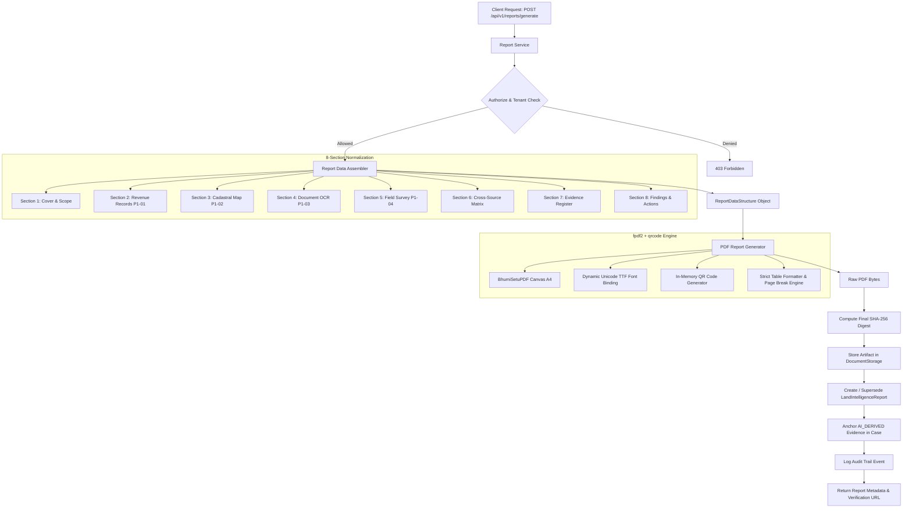

# Engineering Implementation Note: TASK-P1-05 Land Intelligence PDF Report Generator & Evidence Verification

**Component:** `backend/app/services/report_assembler.py`, `backend/app/services/pdf_report_generator.py`, `backend/app/services/report_service.py`, `backend/app/routers/reports.py`, `backend/app/models/report.py`, `backend/app/schemas/report.py`  
**Status:** Completed & Tested (107/107 Tests Passing)  
**Date:** October 2026  
**Parent Roadmap Milestone:** Phase 1 — MVP Core: Land Intelligence Report & Evidence Verification

---

## 1. Initial Repository Audit

Prior to implementation, an exhaustive audit was performed across the Bhumi Setu backend:
1. **Existing Upstream Milestones & Evidence Models:**
   - **P1-01 (Revenue Records):** `Evidence` (type `GOVERNMENT_RECORD`, authority tier `REVENUE_RECORD`), `Claim` with `RECORDED_OWNER`, `TENANT_MUTATION`, and normalized area representation.
   - **P1-02 (Bhu-Naksha Cadastral Maps):** `Parcel.authoritative_boundary` (WGS84 Polygon), spatial area calculation, CRS metadata, topology validity, area variance calculations.
   - **P1-03 (Document Intelligence & OCR):** `Document`, `DocumentVersion`, `ExtractedField`, `ExtractedFieldStatus`, line-level bounding boxes, dedicated 4-direction Chauhaddi schedules, and cross-reference comparisons.
   - **P1-04 (LandAmin Field Task Dispatcher):** `FieldVerificationTask`, `field_surveys`, GNSS point readings, reported accuracy (meters), ground Chauhaddi, physical possessor observations, road access/frontage, and hashed site photo evidence.
   - **Finding & Action System:** `Finding` (`CRITICAL`, `HIGH`, `MEDIUM`, `LOW`, `INFORMATIONAL`), `FindingStatus`, `RequiredAction`, and `Resolution`.
   - **Storage Abstraction:** `DocumentStorage` managing local filesystem persistence and SHA-256 integrity verification.
2. **Identified Architectural Need:**
   - No consolidated reporting entity existed to assemble multi-source land evidence into a single immutable, print-ready document.
   - No public verification mechanism existed for third-party consumers (e.g. lenders, buyers) to cryptographically verify report authenticity without exposing the client's confidential raw records.
3. **Integration Strategy:**
   - Decoupled report assembly (`report_assembler.py`) from PDF rendering (`pdf_report_generator.py`).
   - Persisted metadata in `LandIntelligenceReport` with unique report number, versioning, cryptographic SHA-256 seal, and unguessable verification token.
   - Implemented public verification endpoint with strict data minimization (revealing only tamper-evidence confirmation, scope, and hash match).

---

## 2. Core Product Principle: Evidence Before Conclusions

Bhumi Setu is an evidence-first diligence platform, not a statutory title certification authority. Every generated report strictly enforces epistemic integrity:

1. **Distinction of Evidence Types:**
   - **Source-Record Information:** Persisted government revenue records from Digital Jamabandi Register-II.
   - **Document-Extracted Information:** OCR text extracted from scanned deeds and khatiyans, flagged with extraction confidence and human review status.
   - **Spatial Information:** Cadastral parcel polygons and computed geometric areas from Bhu-Naksha vector maps.
   - **Field Observations:** On-site GNSS readings and ground neighbor interviews submitted by field workers, distinguished by worker-reported vs. reviewer-accepted status.
   - **System-Generated Analysis:** Cross-source discrepancy comparisons, area deltas, and candidate matches.
   - **Human-Reviewed Findings:** Accepted legal review findings with documented reviewer identity and rationale.
   - **Missing or Unresolved Evidence:** Explicitly flagged limitations rather than fabricated completeness.

2. **No False Claims of Authority:**
   - The report **never** claims to be a government-issued certificate, certified cadastral survey demarcation, ownership guarantee, or legal title certificate.
   - It incorporates a mandatory statutory legal disclaimer on both the report cover, footer, verification box, and verification API.

> **Statutory Disclaimer (Embedded in all Reports):**  
> "This report consolidates available records, document extractions, spatial comparisons, and field observations as of the stated generation time. The inclusion of information does not independently establish legal ownership, clear title, possession rights, encumbrance status, or a legally authoritative parcel boundary. Source records, unresolved discrepancies, limitations, and missing evidence should be reviewed by appropriately qualified professionals and relevant authorities."

---

## 3. Architecture & Data Flow

---

## 4. Eight Required Report Sections

Each report is structured into eight traceable sections:

| Section | Title | Primary Source Models | Key Information Presented |
|---|---|---|---|
| **Section 1** | Report Cover & Scope | `Case`, `Parcel`, `Organization` | Report ID, Version, Generated Timestamp with timezone, Location Hierarchy (State, District, Anchal, Mauza), Data Availability Matrix, Important Limitations & Disclaimer. |
| **Section 2** | Parcel Identity & Revenue Records | `Parcel`, `Evidence`, `Claim` | Khata, Khesra/Plot, Jamabandi number, Recorded Area (Original & Normalized Acres), Land Classification, Recorded Raiyat/Tenant, Source Provenance. |
| **Section 3** | Cadastral Map & Spatial Analysis | `Parcel`, `ParcelSpatialCache` | Stored CRS (DILRMP Bihar Grid), Geometry Validation Status, Spatially Calculated Area, Difference in Area (Acres & % variance), Spatial Provenance, Map Limitations. |
| **Section 4** | Document Intelligence & OCR Findings | `Document`, `DocumentVersion`, `ExtractedField` | Document Category, Original Filename, Version, Page Count, OCR Engine, Review Status, Directional Chauhaddi (North, South, East, West), Extracted Key-Values. |
| **Section 5** | LandAmin Field Verification | `FieldVerificationTask`, `field_surveys` | Task Number, Status, Assigned Field Amin, GNSS Readings Count & Reported Accuracy (±m), Ground Measured Area, Physical Possessor, Road Access Type & Frontage, Ground Neighbors Chauhaddi, Site Photos Count & Hashes. |
| **Section 6** | Cross-Source Consistency & Discrepancies | Cross-Reference Service, `Finding` | Matrix comparing Plot Identifiers, Khata/Jamabandi, Area (Recorded vs Cadastral vs Field), Chauhaddi (Deed vs Field). Terminology: `EXACT_MATCH`, `AREA_DISCREPANCY`, `IDENTIFIER_CONFLICT`, `PROBABLE_MATCH`, `NO_MATCH`, `INSUFFICIENT_DATA`. |
| **Section 7** | Consolidated Evidence Register | `Evidence`, `CaseEvidence` | Immutable Register of all supporting artifacts: Evidence Type, Authority Tier, Source System, Ingestion Date, Review Status, and Full SHA-256 Cryptographic Digest. |
| **Section 8** | Findings, Next Actions & Verification | `Finding`, `RequiredAction` | Consolidated list of Open Discrepancies, Action Items, Embedded QR Code pointing to verification URL, Unambiguous Security Token, and Mandatory Legal Disclaimer. |

---

## 5. Report Versioning & Tamper-Evident Integrity

1. **Deterministic Byte Sealing:**
   - The SHA-256 digest is calculated directly from the finalized, rendered PDF binary bytes.
   - When verified, the service recalculates the hash from the stored file to guarantee byte-level consistency against unauthorized modification.
2. **Version Sequencing:**
   - Each report generation for a case automatically increments the report `version_number` (e.g. `v1`, `v2`, `v3`).
   - Prior active reports are marked `status = SUPERSEDED` and linked via `superseded_by_id`, preserving audit history without silent overwriting.
3. **Unguessable Verification Token:**
   - Rather than exposing internal database UUIDs as public verification keys, each report generates a cryptographically secure 256-bit URL-safe token: `secrets.token_urlsafe(32)`.

---

## 6. QR Code & Public Verification Design

### Verification Endpoint: `GET /api/v1/reports/verify/{verification_token}`
- **Public & Unauthenticated:** Lenders, registrars, or buyers can scan the QR code printed on the physical PDF.
- **Strict Data Minimization:** The verification response **only** reveals:
  - `is_valid` (boolean)
  - `status` (`ACTIVE`, `SUPERSEDED`, `REVOKED`)
  - `report_number` & `version_number`
  - `generated_at` timestamp
  - `sha256_hash` (matching stored artifact)
  - `hash_matches_stored_file` (boolean)
  - `scope_summary` (District, Anchal, Mauza, Plot, Khata)
  - `legal_disclaimer`
- **Zero Privacy Leak:** Raw party names (e.g. Raiyats, possessors), private telephone numbers, internal system paths, and raw deed scans are excluded from the public verification response.
- **No Unauthorized Download Access:** Possession of a verification QR code does not grant access to download the full confidential dossier (`/download` requires valid tenant JWT authentication).

---

## 7. API Endpoints

| Method | Route | Description | Auth Required |
|---|---|---|---|
| `POST` | `/api/v1/reports/generate` | Generates a new versioned Land Intelligence Report PDF, stores artifact, records metadata, and updates evidence ledger. | Yes (`ADMIN`, `CASE_OPERATOR`, `LEGAL_REVIEWER`) |
| `GET` | `/api/v1/reports` | Lists all generated reports for a case, scoped to user organization. | Yes (All tenant roles) |
| `GET` | `/api/v1/reports/{report_id}` | Retrieves metadata and summary status for a specific report. | Yes (All tenant roles) |
| `GET` | `/api/v1/reports/{report_id}/download` | Streams the secured PDF file with `application/pdf` MIME type and `inline` or `attachment` Content-Disposition headers. | Yes (Tenant authorized) |
| `GET` | `/api/v1/reports/verify/{verification_token}` | Public verification endpoint validating tamper-evidence and report lifecycle status. | No (Public / Safe Metadata) |

---

## 8. Database Schema & Migration

### Alembic Migration: `b2c3d4e5f6a7_add_land_intelligence_reports.py`
- **Down Revision:** `a1b2c3d4e5f6` (P1-04 LandAmin field verification tasks).
- **Table:** `land_intelligence_reports`
  - `report_id` (UUID, Primary Key)
  - `org_id` (UUID, Foreign Key `organizations.org_id`, indexed) — strict tenant isolation.
  - `case_id` (UUID, Foreign Key `cases.case_id`, indexed)
  - `parcel_id` (UUID, Foreign Key `parcels.parcel_id`, nullable, indexed)
  - `report_number` (String, unique, format `LIR-YYYYMMDD-XXXXXX`)
  - `version_number` (Integer, default 1)
  - `verification_token` (String, unique, indexed)
  - `status` (String: `ACTIVE`, `SUPERSEDED`, `REVOKED`, indexed)
  - `sha256_hash` (String 64 hex characters)
  - `pdf_storage_uri` (String, storage path)
  - `file_size_bytes` (Integer)
  - `page_count` (Integer)
  - `source_snapshots` (JSON: captured snapshot IDs of Jamabandi, Bhu-Naksha, OCR versions, and Field task)
  - `summary_counts` (JSON: counts of documents, evidence items, and open findings)
  - `generated_by_user_id` (UUID, Foreign Key `users.user_id`)
  - `superseded_by_id` (UUID, Foreign Key self-referential `land_intelligence_reports.report_id`, nullable)
  - `created_at`, `updated_at` (Timestamps with timezone)

---

## 9. Verification & Testing

### Regression Test Results
- **Report Generator Tests:** `11/11 PASSED` (`tests/test_report_generator.py`)
  - `test_assemble_report_data_comprehensive`: Confirms all 8 sections populate accurately with real persisted data across P1-01, P1-02, P1-03, P1-04.
  - `test_assemble_report_data_sparse_case`: Confirms graceful degradation when revenue, cadastral, or field data is missing without fabricating data.
  - `test_generate_pdf_bytes_output`: Verifies valid binary PDF structure (`%PDF-`), A4 layout, and non-empty byte streams.
  - `test_api_generate_report_success`: Tests report generation via REST API, evidence anchoring, and audit logging.
  - `test_api_report_versioning_increments`: Confirms multiple generations increment version numbers and mark previous active versions as `SUPERSEDED`.
  - `test_api_download_report_authorized`: Verifies streaming PDF download with correct MIME type and content disposition headers.
  - `test_api_public_qr_verification_endpoint`: Tests public QR verification, hash validation against disk, and data minimization.
  - `test_api_verification_invalid_token_returns_404`: Confirms unknown verification tokens return 404 Not Found.
  - `test_cross_tenant_report_generation_denied`: Prohibits cross-tenant report generation (returns 403 Forbidden).
  - `test_cross_tenant_report_download_denied`: Prohibits cross-tenant PDF downloads (returns 403 Forbidden).
  - `test_unauthorized_role_cannot_generate_report`: Prohibits unauthorized roles (e.g. `FIELD_EXPERT`) from triggering formal report issuance.
- **Full Backend Test Suite:** `107/107 PASSED` in 38.80s (`pytest` across all modules). Zero regressions on P1-01 through P1-04.

---

## 10. Operational Considerations & Deployment

1. **Zero External Scraping During Report Generation:**
   - Reports assemble strictly from local database records and cached geometries. Live government portals are never pinged synchronously during PDF rendering.
2. **Public Base URL Configuration:**
   - Configure environment variable `PUBLIC_BASE_URL` (e.g., `https://bhumisetu.gov.in`) in production to ensure QR codes resolve to the public verification portal.
3. **Storage Security:**
   - PDF files are saved to private storage directories via `DocumentStorage`. File downloads require authenticated JWT sessions matching the tenant organization.
4. **Font Configuration in Containerized Environments:**
   - Container images should install standard TrueType fonts (such as `fonts-dejavu-core` or `ttf-mscorefonts-installer`) to ensure seamless multilingual Unicode and Devanagari rendering.
