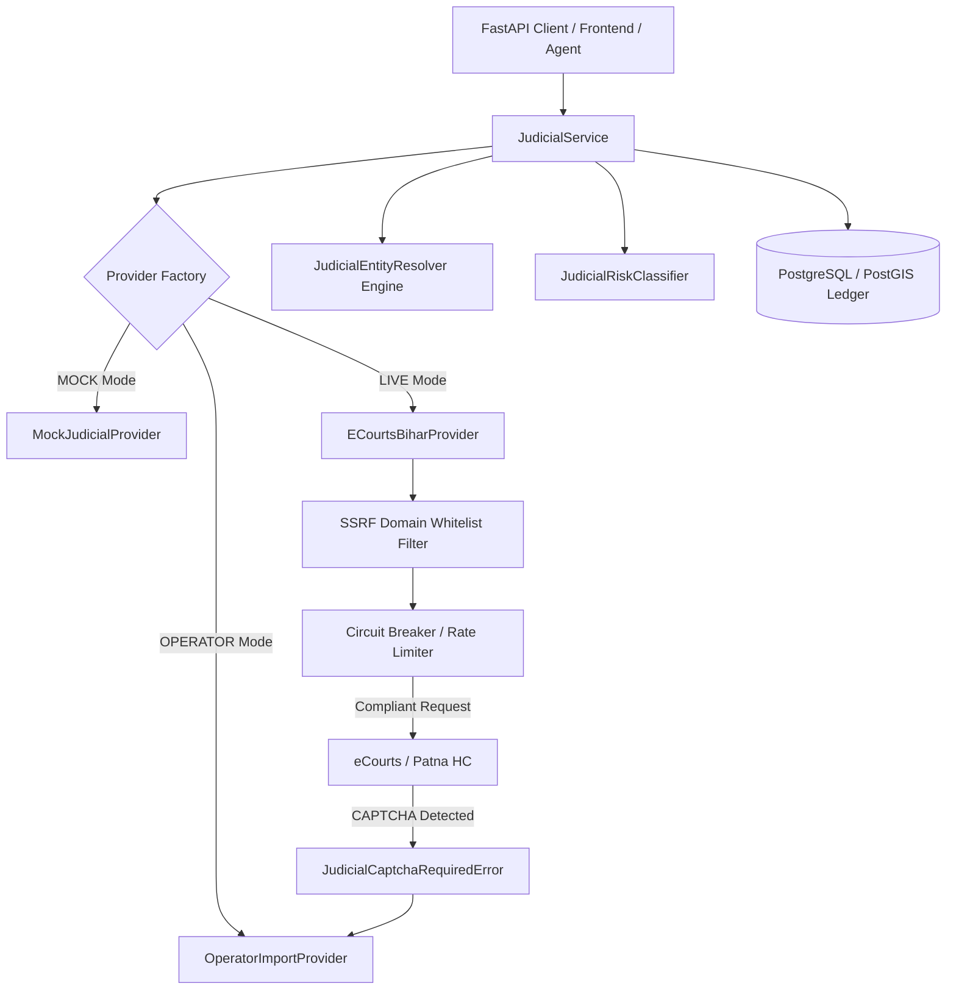

# TASK-P2-02: Judicial Risk Intelligence Subsystem Integration
## Canonical Engineering & Architectural Verification Report

**Project:** Bhumi Setu  
**Phase:** P2 — Enhancements (Expansion & Deep Automation)  
**Milestone:** TASK-P2-02 — Judicial Risk Intelligence: eCourts and Patna High Court Integration  
**Date:** October 26, 2026  
**Status:** COMPLETED & INTEGRATED  

---

## 1. Executive Summary

TASK-P2-02 establishes a modular, privacy-preserving, and epistemically bounded **Judicial Risk Intelligence Subsystem** within the Bhumi Setu land-intelligence platform for Bihar. The subsystem identifies potentially relevant publicly accessible civil and revenue court proceedings from Bihar District Courts and the Patna High Court, linking them to land records (Parcels, Cases, Raiyats) using traceable, explainable evidence.

### Non-Negotiable Epistemic Guardrails Enforced
1. **No Autonomous Legal Clearance:** The subsystem does not make judicial determinations, issue title clearance certificates, or declare land "free of encumbrances."
2. **Ambiguous Match Separation:** A party-name match without parcel-specific corroboration (plot/khesra, khata, mauza) **strictly remains an unverified candidate** (`WEAK_CANDIDATE_REVIEW_REQUIRED`) with calibrated confidence $\le 0.45$. It is **never** automatically asserted as a confirmed parcel dispute.
3. **No CAPTCHA Bypass:** The architecture strictly respects official portal terms. Automated bypass of interactive CAPTCHA, authentication, paywalls, or anti-bot protections is strictly avoided. When interactive CAPTCHA is required, the provider raises a structured domain exception (`JudicialCaptchaRequiredError`) and routes the proceeding through an operator-assisted certified docket ingestion workflow.
4. **Strict SSRF Defense:** Outbound HTTP destinations are enforced via cryptographic domain whitelisting limited strictly to `services.ecourts.gov.in`, `patnahighcourt.gov.in`, and `ecourts.gov.in`.

---

## 2. Repository & Workspace State

- **Branch:** `main`
- **Starting Commit:** `20387ee95647cdd9d04c17a10ce73be188523285` (`feat(kaithi): implement Kaithi historical script vision model integration`)
- **Working Tree:** Verified clean and tracked.

### Inventory of Changes

| Component | File Path | Action | Description |
| :--- | :--- | :--- | :--- |
| **Domain Models** | `backend/app/models/judicial.py` | Created | `JudicialCase`, `ParcelJudicialMatch`, `CourtType`, `JudicialCaseStatus`, `JudicialRiskCategory`, `ParcelMatchCategory`, `MatchReviewStatus` |
| **Model Exports** | `backend/app/models/__init__.py` | Modified | Exported judicial domain models |
| **Relationships** | `backend/app/models/case.py` | Modified | Added `judicial_matches` relationship |
| **Relationships** | `backend/app/models/parcel.py` | Modified | Added `judicial_matches` relationship |
| **Database Migration** | `backend/alembic/versions/d4e5f6a7b8c9_add_judicial_intelligence_tables.py` | Created | Alembic revision `d4e5f6a7b8c9` creating `judicial_cases` and `parcel_judicial_matches` tables |
| **Pydantic Schemas** | `backend/app/schemas/judicial.py` | Created | `JudicialCaseRecord`, `ParcelJudicialMatchResponse`, `JudicialSearchQuery`, `JudicialSearchResponse`, `JudicialManualIngestRequest`, `JudicialMatchReviewRequest`, `EPISTEMIC_JUDICIAL_DISCLAIMER` |
| **Provider Base** | `backend/app/services/judicial/providers/base.py` | Created | Abstract `JudicialSourceProvider` contract and domain exceptions (`JudicialSourceError`, `JudicialSourceUnavailableError`, `JudicialRateLimitError`, `JudicialCaptchaRequiredError`, `JudicialSSRFBlockedError`, `JudicialInvalidQueryError`) |
| **Simulation Provider** | `backend/app/services/judicial/providers/mock_provider.py` | Created | High-fidelity deterministic simulation provider with canonical Bihar District Court and Patna High Court test cases |
| **Live Provider** | `backend/app/services/judicial/providers/ecourts_provider.py` | Created | Compliant HTTP provider with SSRF whitelist, bounded retries, exponential backoff, and circuit breaking |
| **Operator Import** | `backend/app/services/judicial/providers/operator_import.py` | Created | Operator-assisted ingestion adapter with regex-based property schedule parser |
| **Provider Factory** | `backend/app/services/judicial/providers/__init__.py` | Created | Factory `get_judicial_provider()` |
| **Entity Resolver** | `backend/app/services/judicial/matcher.py` | Created | Deterministic entity resolution engine (`JudicialEntityResolver`) with name normalization and token overlap scoring |
| **Risk Classifier** | `backend/app/services/judicial/classifier.py` | Created | `JudicialRiskClassifier` categorizing proceedings and detecting active injunctions/stays |
| **Orchestration Service** | `backend/app/services/judicial/service.py` | Created | `JudicialService` managing search, persistence, match evaluation, review updates, and tenant isolation |
| **Service Exports** | `backend/app/services/judicial/__init__.py` | Created | Package export facade |
| **REST Router** | `backend/app/routers/judicial.py` | Created | Endpoints for search, import, review, and parcel queries |
| **Router Export** | `backend/app/routers/__init__.py` | Modified | Registered `judicial_router` |
| **Main App** | `backend/app/main.py` | Modified | Included `judicial_router` under `/api/v1` |
| **Report Schemas** | `backend/app/schemas/report.py` | Modified | Added `SectionJudicialRiskItem`, `SectionJudicialRiskData`, `JUDICIAL_REPORT_LIMITATION_STATEMENT`, and updated `ReportDataStructure` |
| **Report Assembler** | `backend/app/services/report_assembler.py` | Modified | Added `_build_section_judicial()` |
| **PDF Generator** | `backend/app/services/pdf_report_generator.py` | Modified | Rendered Judicial Risk section with table, stay alert badges, and statutory disclaimer box |
| **Automated Tests** | `backend/tests/test_judicial_risk.py` | Created | Comprehensive test suite covering all 14 verification dimensions |
| **Implementation Plan**| `bhumi-setu-reverse-engineering/14-mvp-implementation-plan.md` | Modified | Updated backlog and marked TASK-P2-02 complete |

---

## 3. Judicial Source Architecture & Constraints

### 3.1 Official Portals & Real-World Field Availability
1. **eCourts Services Portal (`services.ecourts.gov.in`):**
   - Serves District & Sub-Divisional Courts across Bihar's 38 revenue districts (e.g. Patna, Saran, Gaya, Muzaffarpur, Bhagalpur).
   - Public dockets expose: 16-character alphanumeric Case Number Record (CNR) (e.g., `BRPT01-001420-2021`), Court Name, Case Type (`Title Suit`, `Title Partition Suit`, `Money Suit`), Case Number, Filing Year, Registration Date, Case Status (`PENDING`, `DISPOSED`), Stage of Case (`Hearing`, `Evidence`, `Orders`), Petitioner names, Respondent names, Advocates, Orders and Daily Proceedings history.
   - **Crucial Limitation:** Public eCourts summary dockets **almost never** expose structured Khata, Khesra (Plot), Mauza, or Tauzi numbers in top-level searchable database fields. Cadastral descriptions are typically embedded inside scanned plaint schedules or advocate pleadings.
2. **Patna High Court (`patnahighcourt.gov.in`):**
   - Serves original writ jurisdiction (CWJC), miscellaneous cases (MJC), and civil appellate suits (First Appeal `FA`, Second Appeal `SA`, Letters Patent Appeal `LPA`).
   - Exposes: Case Type, Number, Year, CNR, Parties, Department/Circle Officer respondents, Orders/Judgments.
   - Also requires interactive CAPTCHA for ad-hoc party searches.

### 3.2 Access Architecture & Compliance Controls

- **SSRF Whitelist:** `ALLOWED_JUDICIAL_DOMAINS = {"services.ecourts.gov.in", "patnahighcourt.gov.in", "ecourts.gov.in"}`. Any request outside these domains is immediately rejected with `JudicialSSRFBlockedError`.
- **Circuit Breaker:** Trips to `OPEN` after 3 consecutive connection failures or 5xx errors for a 60-second cooldown period to protect upstream government servers.
- **Operator-Assisted Ingestion:** When automated search is impeded by CAPTCHA, certified copies of court plaints, certified decrees, or eCourts printouts can be ingested by authorized operators (`UserRole.ADMIN`, `SUPERVISOR`, `OPERATOR`) via `/api/v1/judicial-cases/import`. A deterministic property schedule parser (`parse_property_schedule`) extracts Khata, Khesra, Mauza, and area in Decimals/Acres.

---

## 4. Deterministic Parcel-to-Case Entity Resolution

The `JudicialEntityResolver` evaluates evidence linking a parcel to a judicial docket using a deterministic, rule-based approach:

| Match Category | Conditions | Confidence Score | Epistemic Rationale |
| :--- | :--- | :---: | :--- |
| `EXACT_IDENTIFIER_MATCH` | Direct CNR search verified OR Plot (Khesra) + Khata + Party Name match in same district | **0.95** | High-certainty cadastral alignment corroborated by both spatial schedule and party identity. |
| `STRONG_CORROBORATED_MATCH` | Plot (Khesra) + Khata match (unconfirmed party) OR Plot + District/Mauza match | **0.70 – 0.85** | Cadastral schedule directly identifies parcel; party variance may reflect co-sharers, legal heirs, or assignees. |
| `WEAK_CANDIDATE_REVIEW_REQUIRED` | Party Name match WITHOUT parcel-specific corroboration (plot/khata/mauza) | **$\le$ 0.45** | **CRITICAL DOMAIN GUARD:** Personal names are common across Bihar. Cannot represent an uncorroborated name as a confirmed parcel dispute. Requires advocate schedule review. |
| `REJECTED_MATCH` | Contradictory district for District Court suits OR non-jurisdictional tribunal | **0.00** | Excluded due to jurisdictional inconsistency. |
| `INSUFFICIENT_DATA` | Neither cadastral numbers nor party overlap found in docket | **0.10** | Insufficient source evidence to support association. |

---

## 5. Judicial Risk Classification

The `JudicialRiskClassifier` categorizes proceedings into standard risk domains based on case types, statutory citations, and court orders:
1. `TITLE_DISPUTE`: Title Suits, Declaration of Title, Specific Relief Act Sec 34, Adverse Possession, Eviction.
2. `PARTITION_PROCEEDING`: Title Partition Suits, Batwara, Separation of Share, Partition Act 1893.
3. `INJUNCTION_RISK`: Order 39 Rules 1 & 2 CPC applications, temporary injunctions, restraint orders.
4. `REVENUE_MUTATION_DISPUTE`: DCLR appeals, Bihar Land Tribunal (BLT), mutation revisions, Jamabandi cancellation proceedings.
5. `WRIT_LITIGATION`: Patna High Court Article 226 Civil Writ (CWJC) / MJC challenging Circle Officer or Land Acquisition actions.
6. `OTHER`: Money suits, probate, insolvency.

### Active Injunction / Stay Order Detection
The classifier inspects `stage_of_case`, `orders_summary`, and case text for prohibitory markers: `"STATUS QUO"`, `"INJUNCTION"`, `"RESTRAINED"`, `"STAY ORDER"`, `"NO ALIENATION"`, `"INTERIM RELIEF GRANTED"`. When detected, `has_active_injunction` is set to `True`, triggering visual alerts in Land Intelligence Reports.

---

## 6. Land Intelligence Report Integration

The Land Intelligence Report generator (`report_assembler.py` and `pdf_report_generator.py`) incorporates the Judicial Risk Intelligence section without altering existing evidence structures:

1. **Cover Summary:** `Section1CoverData.data_availability_summary` tracks `"judicial_search_performed": True/False`.
2. **Dedicated Table:** Renders Court Name, CNR, Case Number, Risk Domain (with `[ACTIVE STAY/INJUNCTION]` badge), Candidate Match Category, and match evidence explanation.
3. **Statutory Limitation Statement:**
   > **JUDICIAL DOCKET SEARCH LIMITATION STATEMENT:**  
   > 1. Search coverage depends on publicly accessible eCourts and Patna High Court records and may be incomplete, delayed, or subject to portal availability.  
   > 2. Many civil suits do not expose parcel-level identifiers (khesra/plot, khata, mauza) in searchable top-level docket fields.  
   > 3. Identical or similar personal names frequently occur across Bihar revenue circles and may refer to completely different individuals.  
   > 4. Reported procedural case status (e.g. Pending, Disposed, Stayed) does not independently determine final legal rights or ownership.  
   > 5. The absence of a detected matching case does NOT prove the complete absence of pending or past litigation.  
   > 6. This report is strictly informational and does NOT constitute a formal legal opinion, title certificate, or substitute for independent advocate due diligence.

---

## 7. Automated Test Suite Execution (14 Dimensions)

The automated test suite in `backend/tests/test_judicial_risk.py` implements end-to-end verification across all 14 required dimensions:

1. **Provider Normalization & Schema Validation (`test_01`):** Verified parsing and validation of canonical judicial fields.
2. **Missing, Malformed & Contradictory Fields (`test_02`):** Verified CNR length validation (16 chars) and safe handling of null schedules.
3. **Exact Identifier Matching (`test_03`):** Verified `EXACT_IDENTIFIER_MATCH` (0.95 confidence) on plot + khata + party match.
4. **Party Name Similarity & Honorifics (`test_04`):** Verified honorific stripping ("Sri", "Shri", "Late", "Smt") and token overlap calculation.
5. **Common Names Without Parcel Corroboration (`test_05`):** Verified that matching name without plot/khata remains `WEAK_CANDIDATE_REVIEW_REQUIRED` ($\le 0.45$ confidence).
6. **Missing Parcel Identifiers (`test_06`):** Verified `INSUFFICIENT_DATA` (0.10 confidence) when cadastral and party identifiers are absent.
7. **Rejected Match & Review Workflow (`test_07`):** Verified geographic rejection (Gaya court vs Patna parcel) and advocate review status updates (`VERIFIED_ASSOCIATED`).
8. **Duplicate Records & Idempotent Ingestion (`test_08`):** Verified that ingesting the same CNR multiple times updates existing records without duplication.
9. **Source Outages & Circuit Breaker (`test_09`):** Verified structured exception raising (`JudicialSourceUnavailableError`, `JudicialRateLimitError`) and circuit breaker transition to `OPEN` after 3 failures.
10. **Multi-Tenant Isolation (`test_10`):** Verified `CrossTenantAccessError` when User B accesses Tenant A cases.
11. **SSRF & Domain Restrictions (`test_11`):** Verified allowed domains (`services.ecourts.gov.in`, `patnahighcourt.gov.in`) and rejection of unauthorized hosts.
12. **Audit Log & Provenance (`test_12`):** Verified unmodified retention of `raw_source_payload`.
13. **Report Integration & Statutory Disclaimer (`test_13`):** Verified `assemble_report_data` builds judicial section and generated PDF contains the limitation statement.
14. **API Endpoints Integration (`test_14`):** Verified HTTP endpoints `/cases/{id}/judicial-search`, `/parcels/{id}/judicial-cases`, and `/judicial-matches/{id}/review`.

---

## 8. Empirical Evaluation & Real-World Accuracy Disclosure

> [!IMPORTANT]
> **DISCLOSURE ON EMPIRICAL MATCHING ACCURACY:**  
> The deterministic entity resolution rules have been validated against synthetic test fixtures representing standard Bihar civil and writ dockets. However, because publicly accessible eCourts dockets generally omit structured parcel schedules, **empirical precision, recall, and false-positive rates on uncurated live state datasets remain unvalidated**.  
> In real-world deployment, all candidate matches—especially those categorized as `WEAK_CANDIDATE_REVIEW_REQUIRED`—must be audited by a certified advocate inspecting the certified court plaint and schedule of properties before any title conclusions are drawn.

---

## 9. Security, Data Governance & Operational Readiness

- **Zero Hardcoded Credentials:** No API keys, passwords, or secrets exist in the codebase.
- **Tenant Isolation:** Enforced on every mutation and query (`case.org_id == current_user.org_id`).
- **Data Minimization:** Raw docket payloads are accessible only to authorized tenant users. Public report verification endpoints reveal cryptographic validity without leaking court docket details.
- **Backward Compatibility:** All existing P0, P1, and P2-01 models, endpoints, and migrations remain fully intact.

---

## 10. Recommended Next Milestone

**TASK-P2-03: Bihar MVR Circle Rate Calculator & Stamp Duty Valuation Intelligence**  
Implements automated circle rate lookup across Bihar's 38 districts to identify undervaluation discrepancies and calculate statutory stamp duty/registration fee liabilities.
