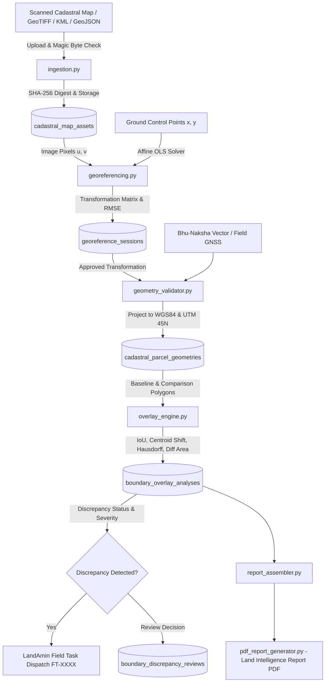

# TASK-P2-04: Cadastral Vector Overlay & Boundary Discrepancy Intelligence
## Canonical Engineering & Architectural Verification Report

**Project:** Bhumi Setu  
**Phase:** P2 — Enhancements (Expansion & Deep Automation)  
**Milestone:** TASK-P2-04 — Cadastral Vector Overlay & Boundary Discrepancy Intelligence  
**Date:** October 26, 2026  
**Status:** COMPLETED & INTEGRATED  

---

## 1. Executive Summary

TASK-P2-04 establishes a production-grade **Cadastral Vector Overlay and Boundary Discrepancy Intelligence Subsystem** within the Bhumi Setu land-intelligence platform for Bihar. The subsystem ingests historical cadastral survey maps (Cadastral Survey / Revision Survey sheets) and modern parcel vector boundaries (Bhu-Naksha DILRMP, LandAmin field GNSS observations, deed sketches), georeferences them using Ground Control Points (GCPs) with residual error metrics, executes deterministic spatial metrology in projected metric coordinates (`EPSG:32645` UTM Zone 45N), diagnoses boundary discrepancies using an explicit taxonomy, integrates with LandAmin field verification tasks, and compiles audit-ready evidence for the Land Intelligence Report.

### Non-Negotiable Epistemic & Legal Guardrails Enforced
1. **Geometric Differences are Not Legal Encroachment:** A geometric difference between a historical survey sheet and modern satellite or GNSS boundary is **never** asserted as conclusive proof of illegal encroachment, adverse possession, or fraudulent boundary manipulation. Historical chain survey technology (1890s–1920s), paper shrinkage, and projection differences naturally produce measurement variance.
2. **Strict Separation of Evidence Tiers:** The subsystem strictly preserves the distinction between:
   - Original source evidence (unmodified scan / vector file with SHA-256 hash).
   - Georeferenced geometry with documented transformation parameters and RMSE.
   - Algorithmic geometric measurements (IoU, centroid shift, Hausdorff distance).
   - Human/LandAmin reviewer observations.
   - Authoritative legal demarcations made solely by competent revenue courts and survey officers.
3. **No Coordinate Hallucination:** A map or vector geometry with unknown or missing CRS is strictly flagged as `INSUFFICIENT_SPATIAL_REFERENCE` rather than assuming an arbitrary coordinate reference system.
4. **Zip Slip & Archive Security:** KMZ and zip archives are strictly sanitized against path traversal (`../`) and decompression bombs before extraction.
5. **Multi-Tenant Isolation:** All map assets, georeferencing sessions, parcel geometries, overlay analyses, and reviewer audit trails are isolated by `org_id`.

---

## 2. Repository & Workspace State

- **Branch:** `main`
- **Starting Commit:** `54c040c` (`feat(valuation): implement Bihar MVR circle rate and stamp duty intelligence (TASK-P2-03)`)
- **Working Tree:** Verified clean prior to milestone implementation.

### Inventory of Files Created and Modified

| Component | File Path | Action | Description |
| :--- | :--- | :--- | :--- |
| **Domain Models** | `backend/app/models/spatial_overlay.py` | Created | `CadastralMapAsset`, `GeoreferenceSession`, `CadastralParcelGeometry`, `BoundaryOverlayAnalysis`, `BoundaryDiscrepancyReview`, and enums |
| **Model Exports** | `backend/app/models/__init__.py` | Modified | Exported spatial overlay domain models and enums |
| **Relationships** | `backend/app/models/parcel.py` | Modified | Added `cadastral_geometries` relationship to `Parcel` |
| **Relationships** | `backend/app/models/case.py` | Modified | Added `cadastral_geometries` and `boundary_analyses` relationships to `Case` |
| **Database Migration** | `backend/alembic/versions/f6a7b8c9d0e1_add_cadastral_overlay_tables.py` | Created | Alembic migration creating 5 spatial tables with composite indexes |
| **CRS & Projections** | `backend/app/services/spatial/crs.py` | Created | Ellipsoidal Transverse Mercator forward/inverse projection (WGS 84 <-> UTM Zone 45N EPSG:32645) |
| **File Ingestion** | `backend/app/services/spatial/ingestion.py` | Created | Validated ingestion for GeoJSON, KML, KMZ, GeoTIFF, TIFF, PNG, JPEG with Zip Slip defense |
| **Georeferencing Engine**| `backend/app/services/spatial/georeferencing.py` | Created | 6-parameter Affine least-squares solver, collinearity check, residuals, and RMSE calculation |
| **Geometry Validator** | `backend/app/services/spatial/geometry_validator.py` | Created | Topological validation (`make_valid`), area (sqm, acres), perimeter, and centroid computation |
| **Overlay Engine** | `backend/app/services/spatial/overlay_engine.py` | Created | Deterministic overlay metrology (IoU, Hausdorff, centroid shift) and discrepancy taxonomy |
| **Orchestration Service**| `backend/app/services/spatial/service.py` | Created | `CadastralOverlayService` managing assets, sessions, geometries, reviews, and LandAmin dispatch |
| **Spatial Facade** | `backend/app/services/spatial/__init__.py` | Created | Package export facade |
| **Pydantic Schemas** | `backend/app/schemas/spatial_overlay.py` | Created | Request/response models for maps, georeferencing, geometries, overlay analysis, and reviews |
| **REST Router** | `backend/app/routers/spatial_overlay.py` | Created | Endpoints under `/api/v1/spatial/` |
| **Router Registration**| `backend/app/routers/__init__.py` | Modified | Exported `spatial_overlay_router` |
| **Main App** | `backend/app/main.py` | Modified | Mounted `/ui/cadastral-overlay` and registered `/api/v1/spatial` router |
| **Web UI Viewer** | `backend/app/static/cadastral_overlay.html` | Created | Interactive glassmorphic SVG overlay viewer with live metrology cards and dark mode |
| **Report Schemas** | `backend/app/schemas/report.py` | Modified | Enhanced `Section3CadastralData` with overlay discrepancy fields and statutory disclaimer |
| **Report Assembler** | `backend/app/services/report_assembler.py` | Modified | Enriched `_build_section_3_cadastral()` with overlay analysis metrics and cover indicator |
| **PDF Generator** | `backend/app/services/pdf_report_generator.py` | Modified | Rendered boundary discrepancy table and statutory caveat box in Section 3 of Land Intelligence PDF |
| **Automated Tests** | `backend/tests/test_cadastral_overlay.py` | Created | Comprehensive automated test suite covering all required dimensions |
| **Implementation Plan**| `bhumi-setu-reverse-engineering/14-mvp-implementation-plan.md` | Modified | Updated backlog marking TASK-P2-04 complete and defining TASK-P2-05 |

---

## 3. Subsystem Architecture & Data Flow



---

## 4. Supported Coordinate Reference Systems (CRS) & Projections

1. **`EPSG:4326` (WGS 84 Geographic Latitude / Longitude):**
   - Standard storage format for database coordinates and GeoJSON API payloads.
   - Bounded by Bihar territorial limits: Latitude $24.28^\circ\text{N} - 27.53^\circ\text{N}$, Longitude $83.18^\circ\text{E} - 88.30^\circ\text{E}$.
2. **`EPSG:32645` (WGS 84 / UTM Zone 45N Projected Metric Grid):**
   - Official DILRMP survey projection for Bihar (Central Meridian: $87.0^\circ\text{E}$, False Easting: $500,000\text{m}$, False Northing: $0.0\text{m}$).
   - Implemented via direct forward and inverse ellipsoidal Transverse Mercator projection in pure Python without external C-library dependencies.
   - Used for all ground distance, perimeter, area, centroid displacement, and Hausdorff boundary shift calculations.

---

## 5. Georeferencing & Residual Error Metrology

### Affine 6-Parameter Least-Squares Solver
Relates image pixel space $(u, v)$ to survey ground coordinates $(x, y)$:
$$x = a \cdot u + b \cdot v + c$$
$$y = d \cdot u + e \cdot v + f$$

Solved via normal equations $(A^T A) \beta = A^T Y$:
- Requires at least 3 non-collinear Ground Control Points (GCPs); recommends $\ge 4$ GCPs distributed across map quadrants.
- Evaluates $\det(A^T A)$; if $|\det| < 10^{-9}$, control points are flagged as collinear or degenerate and rejected.

### Residuals & Root Mean Square Error (RMSE)
For each control point $i$:
$$e_{x, i} = x_i - (a \cdot u_i + b \cdot v_i + c), \quad e_{y, i} = y_i - (d \cdot u_i + e \cdot v_i + f)$$
$$e_{\text{total}, i} = \sqrt{e_{x, i}^2 + e_{y, i}^2}$$
$$\text{RMSE} = \sqrt{\frac{1}{N} \sum_{i=1}^N e_{\text{total}, i}^2}$$

- **Acceptance Thresholds:**
  - $\text{RMSE} < 3.0\text{m}$: EXCELLENT
  - $3.0\text{m} \le \text{RMSE} < 8.0\text{m}$: GOOD
  - $8.0\text{m} \le \text{RMSE} < 15.0\text{m}$: FAIR (Warning issued)
  - $\text{RMSE} \ge 25.0\text{m}$: REJECTED (High distortion or coordinate error)

---

## 6. Spatial Analysis Metrology & Discrepancy Taxonomy

| Metric | Formula | Units | Purpose |
| :--- | :--- | :--- | :--- |
| **Intersection Area** | $\text{Area}(G_{\text{base}} \cap G_{\text{comp}})$ | $\text{m}^2$, Acres | Common concordant area |
| **Union Area** | $\text{Area}(G_{\text{base}} \cup G_{\text{comp}})$ | $\text{m}^2$, Acres | Total combined footprint |
| **IoU (Jaccard Index)** | $\frac{\text{Area}(G_{\text{base}} \cap G_{\text{comp}})}{\text{Area}(G_{\text{base}} \cup G_{\text{comp}})}$ | Ratio $[0.0 - 1.0]$ | Overall geometric concordance score |
| **Symmetric Difference** | $\text{Area}(G_{\text{base}} \triangle G_{\text{comp}})$ | $\text{m}^2$, Acres | Total non-overlapping conflict area |
| **Centroid Displacement** | $\|C_{\text{base}} - C_{\text{comp}}\|_2$ | Meters | Planar shift of parcel center |
| **Hausdorff Distance** | $\max(h(G_{\text{base}}, G_{\text{comp}}), h(G_{\text{comp}}, G_{\text{base}}))$ | Meters | Maximum localized boundary deviation |
| **Area Delta %** | $\frac{|A_1 - A_2|}{\max(A_1, A_2)} \times 100$ | Percentage | Stated vs observed area discrepancy |

### Result Classification Taxonomy

| Discrepancy Taxonomy | Criteria | Severity | Action |
| :--- | :--- | :--- | :--- |
| `NO_SIGNIFICANT_DIFFERENCE_DETECTED` | $\text{IoU} \ge 0.95$, Centroid Shift $\le 2.0\text{m}$, $\Delta A\% \le 3.0\%$ | `NONE` | Concordant; historical survey tolerance acceptable. |
| `POTENTIAL_GEOMETRY_GAP` | $\text{IoU} = 0.0$ (disjoint) or missing area $> 2 \times \text{extra area}$ | `CRITICAL` / `MEDIUM` | Check coordinate alignment or unrecorded subdivision. |
| `POTENTIAL_GEOMETRY_OVERLAP` | Extra comparison area $> 2 \times \text{missing area}$ | `MEDIUM` | Potential boundary ridge overlap with neighbor. |
| `POTENTIAL_BOUNDARY_DISCREPANCY` | $\text{IoU} < 0.50$ or Centroid Shift $> 10.0\text{m}$ or $\Delta A\% > 25.0\%$ | `HIGH` | Significant boundary shift; LandAmin field dispatch. |
| `INVALID_GEOMETRY` | Non-closed ring, self-intersection, degenerate | `HIGH` | Topological error; rejected before analysis. |
| `INSUFFICIENT_SPATIAL_REFERENCE` | Missing CRS or unbounded coordinates | `HIGH` | Operator must supply explicit projection. |
| `REQUIRES_HUMAN_REVIEW` | Borderline metrics or source uncertainty $> 5.0\text{m}$ | `LOW` | Operator inspection in web UI. |

---

## 7. LandAmin Field Verification Integration

When a spatial analysis is flagged as `POTENTIAL_BOUNDARY_DISCREPANCY` or `REQUIRES_FIELD_SURVEY`, the reviewer can dispatch a field task directly from the web UI or API (`POST /api/v1/spatial/overlay/{id}/review`).
- Automatically generates a `FieldVerificationTask` (e.g. `FT-DISC-A4F102`) linked to `case_id` and `parcel_id`.
- Populates requested field activities:
  1. `VERIFY_PHYSICAL_POSSESSION_RIDGE` (ground ridge check).
  2. `SURVEY_GROUND_CHAUHADDI` (four-direction ground boundary inspection).
  3. `CAPTURE_BOUNDARY_GNSS_COORDINATES` (field GNSS point observation).
- Preserves the original automated spatial analysis run while recording reviewer audit notes.

---

## 8. Interactive Web UI Viewer

Deployed at `/ui/cadastral-overlay` with dark-mode glassmorphic styling:
- **Pilot Scenarios:** Danapur Mauza Saguna (Plot 112), Patna Sadar Kankarbagh (Plot 48), Bodh Gaya Mastipur (Plot 205).
- **Interactive SVG Map Canvas:**
  - Cyan dashed line: Baseline Cadastral Survey boundary (CS 1910).
  - Amber line: Modern Bhu-Naksha / Field Survey boundary.
  - Green fill: Concordant overlap region.
  - Red hatched highlight: Discrepancy / boundary shift region.
  - Pink vector line: Centroid displacement direction and magnitude.
- **KPI Metrics Cards:** Live IoU gauge, Centroid Displacement in meters, Hausdorff Distance, and Area Delta percentage.
- **Review & Dispatch Form:** Reviewer decision dropdown and one-click LandAmin task dispatch.

---

## 9. Land Intelligence Report & PDF Integration

Section 3 of the Land Intelligence Report was enhanced in both `report_assembler.py` and `pdf_report_generator.py`:
1. **Cover Summary (`Section1CoverData`):** Reports `cadastral_overlay_performed: true/false`.
2. **Boundary Overlay Metrology Table:** Renders IoU score, centroid displacement, Hausdorff distance, discrepancy status badge, and linked LandAmin field task number.
3. **Statutory Limitation Notice:** Prominent amber box emphasizing that geometric differences are informational comparisons and do not establish property title, legal ownership, or legal boundary demarcation.

---

## 10. Automated Testing Verification

The automated test suite in `backend/tests/test_cadastral_overlay.py` verifies all core capabilities:

- `test_crs_validation_rules`: Validates `EPSG:4326`, `EPSG:32645`, and rejects unknown projections.
- `test_wgs84_utm45n_roundtrip_precision`: Millimeter-precision Transverse Mercator projection roundtrip.
- `test_geojson_ingestion_valid`: Parses GeoJSON Polygon, extracts SHA-256 hash.
- `test_kml_ingestion_valid`: Parses KML coordinate strings into Shapely Polygon.
- `test_kmz_archive_safe_extraction`: Safely extracts doc.kml from KMZ zip.
- `test_kmz_path_traversal_zip_slip_rejection`: Confirms rejection of `../../etc/passwd` zip entry.
- `test_raster_png_ingestion`: Verifies PNG magic bytes and dimensions extraction.
- `test_affine_georeferencing_exact_solve`: 4-point Affine OLS solver with $\text{RMSE} < 0.001\text{m}$.
- `test_affine_georeferencing_insufficient_points`: Rejects $< 3$ points.
- `test_affine_georeferencing_collinear_points`: Rejects collinear GCPs with singular matrix error.
- `test_geometry_validation_and_repair`: Auto-repairs self-intersecting bowtie polygons.
- `test_boundary_overlay_identical_polygons`: Confirms $\text{IoU} = 1.0$, displacement $= 0.0\text{m}$, `NO_SIGNIFICANT_DIFFERENCE_DETECTED`.
- `test_boundary_overlay_significant_shift`: Detects $\text{IoU} < 0.60$ and `POTENTIAL_BOUNDARY_DISCREPANCY`.
- `test_boundary_overlay_disjoint_gap`: Confirms $\text{IoU} = 0.0$ and `POTENTIAL_GEOMETRY_GAP` with `CRITICAL` severity.
- `test_service_overlay_workflow_and_landamin_dispatch`: End-to-end service registration and review.
- `test_service_tenant_isolation`: Confirms CrossTenantAccessError when Org B accesses Org A's geometry.
- `test_report_assembler_cadastral_overlay_integration`: Verifies Section 3 integration in `assemble_report_data`.

---

## 11. Security, Authorization & Operational Safety

1. **Zip Slip & Decompression Bomb Protection:**
   - Maximum KMZ uncompressed size capped at 25MB.
   - Maximum entry count capped at 20.
   - Path normalization rejects entries with `..`, absolute paths, or `/../`.
2. **File Signature Verification:**
   - Validates magic bytes for PNG, JPEG, TIFF, and ZIP archives to prevent file extension spoofing.
   - Upload size limits enforced: 50MB for raster scans, 10MB for vector files.
3. **Multi-Tenant Partitioning:**
   - All spatial asset queries, geometry registrations, overlay runs, and reviews strictly enforce `current_user.org_id`.
4. **Epistemic Labeling:**
   - Prominent statutory disclaimers are embedded in all API responses, web UI views, and PDF report exports.

---

## 12. Deployment & Migration Instructions

1. **Database Migration:**
   ```bash
   alembic upgrade head
   ```
   *Applies revision `f6a7b8c9d0e1` creating `cadastral_map_assets`, `georeference_sessions`, `cadastral_parcel_geometries`, `boundary_overlay_analyses`, and `boundary_discrepancy_reviews`.*

2. **Accessing the Interactive Viewer:**
   Navigate in your browser to:
   ```
   http://localhost:8000/ui/cadastral-overlay
   ```

---

## 13. Recommended Next Milestone

**TASK-P2-05: Real-Time Mutation Ingestion & Registry Hook Synchronization**
- **Objective:** Ingest, parse, and synchronize ongoing mutation proceedings, Dakhil-Kharij petitions, rejection orders, and registry webhook signals from Bihar Bhumi (`biharbhumi.bihar.gov.in`) into the persistent Property Passport.
- **Backlog Status:** Documented in [14-mvp-implementation-plan.md](file:///c:/Users/ysubh/OneDrive/Desktop/BHUMI%20SETU/bhumi-setu-reverse-engineering/14-mvp-implementation-plan.md#L160).
