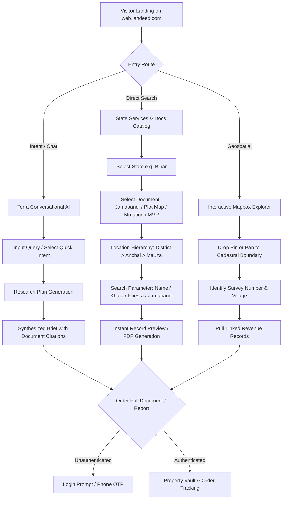

# 03 - Observed User Workflows

**Investigation Target:** Landeed Web App (`web.landeed.com`)  
**Audit Date:** October 24, 2026  
**Auditor:** Bhumi Setu Engineering Intelligence  

---

## 1. End-to-End Workflow Architecture

Through passive observation, CDP inspection, and active interaction via Chromium DevTools, five primary user workflows were observed:

---

## 2. Detailed Workflow Breakdowns

### 2.1 Workflow 1: Bihar Jamabandi (Register-II) Record Retrieval
* **Route:** `/bihar/jamabandi`
* **Trigger:** User wishes to verify land ownership, area, and Khata/Khesra numbers in Bihar.
* **Step-by-Step Flow:**
  1. **Breadcrumb / Context:** User arrives with state preset to Bihar.
  2. **Location Selection:** User clicks `Village/Division` input (`uid=5_21`), opening a cascading modal dialog.
  3. **Hierarchical Drill-Down:**
     - Select District (e.g. *Patna, Gaya, Muzaffarpur, Bhagalpur*).
     - Select Circle / Anchal (e.g. *Sampatchak, Phulwari, Danapur*).
     - Select Mauza / Village (e.g. *Kothawan, Jethuli*).
  4. **Search Method Selector:** An extensible button toggles between supported criteria:
     - *Search by Rayat (Owner) Name* (e.g. "Ram Kumar")
     - *Search by Khata Number*
     - *Search by Khesra / Plot Number*
     - *Search by Jamabandi Number*
     - *Search by Deed Number (Registered)*
  5. **Submission:** Form triggers a backend query to `emutation.bihar.gov.in` via Landeed's backend adapter.
  6. **Result View:** Displays digitized Jamabandi ledger:
     - Jamabandi Number
     - Rayat Name & Father's Name
     - Caste & Gender (where recorded)
     - Khata & Khesra numbers
     - Rakba (Area in Acre, Decimal, Bigha, Katha, Dhur)
     - Lagan (Land revenue tax demand and cess)
     - Mutation case reference (Vadh Sankhya)

### 2.2 Workflow 2: Map-Based Cadastral Exploration
* **Route:** `web.landeed.com/` (Map Tab)
* **Underlying Engine:** Mapbox GL JS with custom raster/vector cadastral tile layers (`api.mapbox.com/v4/...`).
* **Step-by-Step Flow:**
  1. Interactive map viewport centers on user's geo-located coordinates (resolved via `ipinfo.io/json`).
  2. User pans and zooms to target village.
  3. User drops a pin or clicks a parcel boundary.
  4. Client emits CDP/Network request with latitude/longitude.
  5. Backend resolves point-in-polygon against cadastral vector maps (Bhu-Naksha polygons).
  6. Overlay drawer pops up displaying:
     - Survey Number / Khesra Number
     - Mauza Name
     - Recorded Area
     - CTA: *"View Jamabandi"* / *"Order Title Search"*

### 2.3 Workflow 3: Conversational Intelligence ("Ask Terra")
* **Route:** `web.landeed.com/terra`
* **Engine Observed:** `Terra 3.5 Beta` / `Terra 4.0` (Backend: `bedrock.landeed.com`).
* **Preset Prompt Categories (Observed in `landeed_categories_bihar.json`):**
  - **Know Before You Buy:** Ownership history, past owners, liens, disputes, legal owner verification.
  - **Explore the Map:** Registered deeds near pin, street transaction history, guidance value vs. market rate.
  - **Get Certified Proof:** Encumbrance Certificate (EC), Registered Sale Deed, RoR/Pahani/7-12, Tax receipts.
  - **Ancestral Records:** Lineage tracing, unbroken chain of title, origin of ownership, flag disputed transfers.
* **Execution Flow:**
  - When user sends a prompt, the system breaks the query into an **auditable research plan**.
  - Checks state coverage via `check_coverage`.
  - Reads available sources into structured findings.
  - Returns a concise summary with numeric footnotes linking to issuing offices and document numbers.

### 2.4 Workflow 4: Professional Legal Opinion & Services
* **Route:** `web.landeed.com/services/bihar`
* **Four Core Bihar Services:**
  1. **Bihar Legal Opinion:** Expert title and legal status report signed by an advocate.
  2. **Bihar Fix My Property Consultation:** Rectification of corrupted revenue records (Parimarjan Plus filing, mutation correction).
  3. **Bihar Property Protection Consultation:** Title audit, preventive caveat, periodic monitoring.
  4. **Bihar Land Survey:** Physical field survey by a certified surveyor / revenue amin to demarcate boundaries and area.

---

## 3. UI States & Fallbacks

* **Unauthenticated State:** Core searches and previews are accessible; downloading full certified PDFs, accessing the Property Vault, and tracking past orders require phone OTP login.
* **No Match / Ambiguity State:** When a name matches multiple parties in the same Mauza, the system returns a disambiguation table with Father's Name and Jamabandi Number rather than making an arbitrary single selection.
* **Source Downtime State:** If a government NIC server (e.g. `biharbhumi.bihar.gov.in`) fails or returns a 503, the interface reports: *"Revenue office registry is temporarily unreachable; your request has been queued for automatic retry."*
