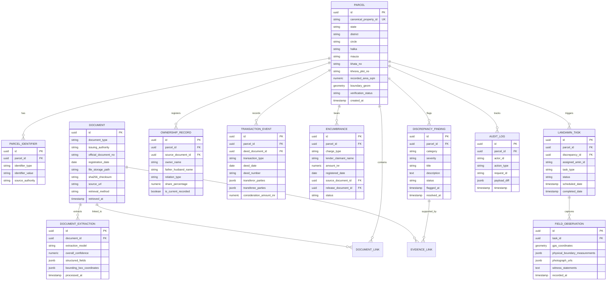

# 09 - Property Data Model Specification

**Project:** Bhumi Setu  
**Document:** Entity-Relationship Diagram & Database Schema  
**Target RDBMS:** PostgreSQL 16+ with PostGIS Extension (SQLite compatible for local development)  
**Date:** October 24, 2026  

---

## 1. Entity-Relationship Diagram (ERD)



---

## 2. Core DDL Schema Definition (PostgreSQL / PostGIS)

```sql
-- Enable PostGIS spatial extension
CREATE EXTENSION IF NOT EXISTS postgis;
CREATE EXTENSION IF NOT EXISTS "uuid-ossp";

-- 1. Master Parcels Table
CREATE TABLE parcels (
    id UUID PRIMARY KEY DEFAULT uuid_generate_v4(),
    canonical_property_id VARCHAR(64) UNIQUE NOT NULL, -- e.g., 'BR-PAT-DAN-KOT-KH12-PL45'
    state VARCHAR(50) NOT NULL DEFAULT 'Bihar',
    district VARCHAR(100) NOT NULL,
    circle VARCHAR(100) NOT NULL,
    halka VARCHAR(100),
    mauza VARCHAR(100) NOT NULL,
    khata_no VARCHAR(50) NOT NULL,
    khesra_plot_no VARCHAR(50) NOT NULL,
    recorded_area_sqm NUMERIC(12, 4),
    boundary_geom GEOMETRY(Polygon, 4326),
    verification_status VARCHAR(32) NOT NULL DEFAULT 'UNVERIFIED', -- 'UNVERIFIED', 'PROVISIONAL', 'VERIFIED', 'FLAGGED'
    created_at TIMESTAMP WITH TIME ZONE DEFAULT CURRENT_TIMESTAMP,
    updated_at TIMESTAMP WITH TIME ZONE DEFAULT CURRENT_TIMESTAMP
);

CREATE INDEX idx_parcels_location ON parcels(state, district, circle, mauza);
CREATE INDEX idx_parcels_khata_khesra ON parcels(khata_no, khesra_plot_no);
CREATE INDEX idx_parcels_spatial ON parcels USING GIST(boundary_geom);

-- 2. Document Master Ledger
CREATE TABLE documents (
    id UUID PRIMARY KEY DEFAULT uuid_generate_v4(),
    document_type VARCHAR(64) NOT NULL, -- 'JAMABANDI_PANJI2', 'SALE_DEED', 'BHUNAKSHA_MAP', 'EC_FORM15', 'MUTATION_EXTRACT'
    issuing_authority VARCHAR(128) NOT NULL, -- 'Bihar LRC', 'IGRS Bihar', 'Survey Dept'
    official_document_no VARCHAR(128),
    registration_date DATE,
    file_storage_path TEXT NOT NULL,
    sha256_checksum CHAR(64) NOT NULL,
    source_url TEXT,
    retrieval_method VARCHAR(32) NOT NULL, -- 'DIGITAL_SOURCE', 'SRO_COUNTER_AMN', 'USER_UPLOAD'
    retrieved_at TIMESTAMP WITH TIME ZONE DEFAULT CURRENT_TIMESTAMP
);

CREATE INDEX idx_documents_checksum ON documents(sha256_checksum);

-- 3. Document Extractions & Bounding Boxes
CREATE TABLE document_extractions (
    id UUID PRIMARY KEY DEFAULT uuid_generate_v4(),
    document_id UUID NOT NULL REFERENCES documents(id) ON DELETE CASCADE,
    extraction_model VARCHAR(64) NOT NULL,
    overall_confidence NUMERIC(5, 2) NOT NULL,
    structured_fields JSONB NOT NULL,
    bounding_box_coordinates JSONB NOT NULL,
    processed_at TIMESTAMP WITH TIME ZONE DEFAULT CURRENT_TIMESTAMP
);

-- 4. Discrepancies and Findings
CREATE TABLE discrepancy_findings (
    id UUID PRIMARY KEY DEFAULT uuid_generate_v4(),
    parcel_id UUID NOT NULL REFERENCES parcels(id) ON DELETE CASCADE,
    category VARCHAR(64) NOT NULL, -- 'NAME_VARIANCE', 'AREA_MISMATCH', 'UNRELEASED_MORTGAGE', 'BROKEN_CHAIN', 'BOUNDARY_CONFLICT'
    severity VARCHAR(16) NOT NULL, -- 'LOW', 'MEDIUM', 'HIGH', 'CRITICAL'
    title VARCHAR(255) NOT NULL,
    description TEXT NOT NULL,
    evidence_document_ids UUID[] DEFAULT '{}',
    status VARCHAR(32) NOT NULL DEFAULT 'OPEN', -- 'OPEN', 'AMN_VERIFICATION_PENDING', 'ADVOCATE_REVIEW', 'RESOLVED'
    resolution_notes TEXT,
    flagged_at TIMESTAMP WITH TIME ZONE DEFAULT CURRENT_TIMESTAMP,
    resolved_at TIMESTAMP WITH TIME ZONE
);

CREATE INDEX idx_findings_parcel ON discrepancy_findings(parcel_id);

-- 5. LandAmin Tasks & Field Observations
CREATE TABLE landamin_tasks (
    id UUID PRIMARY KEY DEFAULT uuid_generate_v4(),
    parcel_id UUID NOT NULL REFERENCES parcels(id) ON DELETE CASCADE,
    discrepancy_id UUID REFERENCES discrepancy_findings(id) ON DELETE SET NULL,
    assigned_amin_id VARCHAR(64) NOT NULL,
    task_type VARCHAR(64) NOT NULL, -- 'BOUNDARY_DEMARCATION', 'POSSESSION_INSPECTION', 'PANCHNAMA_COLLECTION'
    status VARCHAR(32) NOT NULL DEFAULT 'ASSIGNED', -- 'ASSIGNED', 'IN_PROGRESS', 'SUBMITTED', 'VERIFIED'
    created_at TIMESTAMP WITH TIME ZONE DEFAULT CURRENT_TIMESTAMP,
    completed_at TIMESTAMP WITH TIME ZONE
);

CREATE TABLE field_observations (
    id UUID PRIMARY KEY DEFAULT uuid_generate_v4(),
    task_id UUID NOT NULL REFERENCES landamin_tasks(id) ON DELETE CASCADE,
    gps_coordinates GEOMETRY(Point, 4326),
    physical_measurements JSONB NOT NULL,
    photo_urls TEXT[] DEFAULT '{}',
    witness_notes TEXT,
    recorded_at TIMESTAMP WITH TIME ZONE DEFAULT CURRENT_TIMESTAMP
);
```
