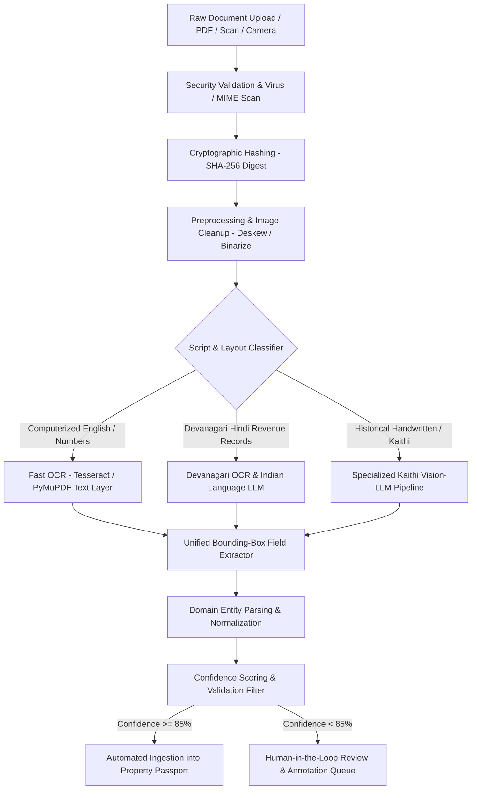

# 10 - Document Intelligence & OCR Pipeline Design

**Project:** Bhumi Setu  
**Document:** Technical Specification for Land Document Ingestion, Classification, OCR, and Extraction  
**Date:** October 24, 2026  

---

## 1. Document Pipeline Overview

Indian land documents present unique extraction challenges:
* **Heterogeneous physical states:** Centuries-old physical papers, microfilms, dot-matrix printed government challans, and modern computerized receipts.
* **Complex linguistic mixing:** Mixed English, Hindi Devanagari, Urdu legal terminology (e.g., *Hiba, Bai-Nama, Chauhaddi, Rayat, Khatian, Jamabandi, Khesra, Rakba*), and historical **Kaithi script** (dominant in pre-1970 Bihar revenue records).
* **High legal consequence:** A misinterpreted digit in a survey plot number (e.g., Khesra `142` vs. `142/1`) can represent an entirely different property.



---

## 2. Secure Document Upload & Validation

1. **MIME and Header Enforcement:** Only `application/pdf`, `image/png`, `image/jpeg`, and `image/tiff` are permitted. Magic byte inspection rejects disguised binaries.
2. **File Size Limits:** Maximum 50 MB per file (enforced at API Gateway).
3. **Immutability & Checksums:** Files are immediately checksummed with SHA-256. If a duplicate checksum is detected for the same property, the system references the existing canonical storage record.
4. **Malicious Content Sanitization:** Scanned PDFs are flattened to strip embedded JavaScript, dynamic forms, or macros that could exploit PDF rendering engines.

---

## 3. Specialized Kaithi & Hindi Script Engine

### 3.1 The Kaithi Script Problem in Bihar
* Bihar's historical land revenue archives (Cadastral Survey 1898–1920, Revision Survey 1965–1975) are overwhelmingly written in **Kaithi** (कैथी), an archaic cursive script historically used for legal and administrative records across northern India.
* Standard OCR engines (Google Cloud Vision, Tesseract) fail completely on Kaithi, producing gibberish characters or hallucinated English.
* The Bihar Government recently released an official Kaithi tutorial booklet (*"कैथी लिपि पाठ्य पुस्तिका"*, observed on `biharbhumi.bihar.gov.in`).

### 3.2 Bhumi Setu's Dual-Model Translation Strategy
1. **Visual Tokenizer:** Custom fine-tuned Vision-Language Model trained on annotated Bihar Khatiyan and deed datasets.
2. **Lexical Domain Grammar:** Extracted tokens are constrained against a standardized **Bihar Revenue Glossary** containing historical administrative words:
   - *Mauza* (मौजा) - Village revenue boundary
   - *Thana Number* (थाना संख्या) - Revenue police station identification
   - *Tauzi* (तौजी) - Revenue roll number
   - *Khata* (खाता) - Tenant account record
   - *Khesra* (खेसरा) - Field plot number
   - *Chauhaddi* (चौहद्दी) - Four boundaries (North, South, East, West)
   - *Rakba* (रकबा) - Land area measurement
   - *Malguzari / Lagan* (मालगुजारी / लगान) - Annual land rent

---

## 4. Structured Schema Extraction & Bounding Boxes

Every extracted field is stored with its source bounding-box coordinates `[page_no, xmin, ymin, xmax, ymax]`. When an end user or auditor reviews a finding, clicking the field immediately highlights the exact physical text snippet on the source PDF.

### Normalized Field Schema (Sample Sale Deed Extraction)
```json
{
  "document_id": "doc_8f12a9bc",
  "document_type": "REGISTERED_SALE_DEED",
  "issuing_office": "Sub-Registrar Office, Danapur, Patna",
  "registration_details": {
    "deed_number": "14521/2018",
    "book_number": "1",
    "volume_number": "42",
    "pages": "112-124",
    "registration_date": "2018-05-14",
    "confidence": 0.98,
    "bbox": [1, 120, 45, 340, 68]
  },
  "parties": {
    "transferors": [
      {
        "name": "Rameshwar Prasad Singh",
        "father_name": "Late Jagannath Singh",
        "address": "Village Kothawan, Danapur, Patna",
        "share": "100%",
        "confidence": 0.96,
        "bbox": [2, 100, 210, 420, 240]
      }
    ],
    "transferees": [
      {
        "name": "Sunil Kumar",
        "father_name": "Satyanarayan Kumar",
        "address": "Danapur Cantt, Patna",
        "confidence": 0.97,
        "bbox": [2, 100, 280, 410, 310]
      }
    ]
  },
  "property_schedule": {
    "district": "Patna",
    "anchal": "Danapur",
    "mauza": "Kothawan",
    "thana_no": "23",
    "khata_no": "48",
    "khesra_no": "112",
    "transferred_area": {
      "raw_text": "5 Katha 10 Dhur",
      "normalized_sqm": 696.77,
      "confidence": 0.95,
      "bbox": [3, 85, 140, 290, 165]
    },
    "chauhaddi": {
      "north": "Plot 111 (Nandlal Singh)",
      "south": "Road 12ft wide",
      "east": "Plot 113 (Self)",
      "west": "Plot 110 (Mahesh Prasad)",
      "bbox": [3, 90, 180, 480, 220]
    }
  },
  "financials": {
    "consideration_amount_inr": 2500000.00,
    "government_mvr_value_inr": 2150000.00,
    "stamp_duty_paid_inr": 150000.00,
    "registration_fee_inr": 50000.00
  }
}
```

---

## 5. Human-in-the-Loop Reviewer Interface

When an extraction confidence score falls below 85% or an ambiguous field conflict is detected:
1. The document is flagged in the **Review Queue** (`backend/app/routers/evidence.py`).
2. An authorized land reviewer or legal associate views the split-screen Document Viewer UI:
   - Left side: High-resolution zoomable PDF scan.
   - Right side: Extracted structured JSON form.
3. Reviewer confirms, edits, or flags illegible sections.
4. All modifications are recorded as a new extraction version in `document_extractions` with the reviewer's User ID and timestamp, preserving complete audit provenance.
