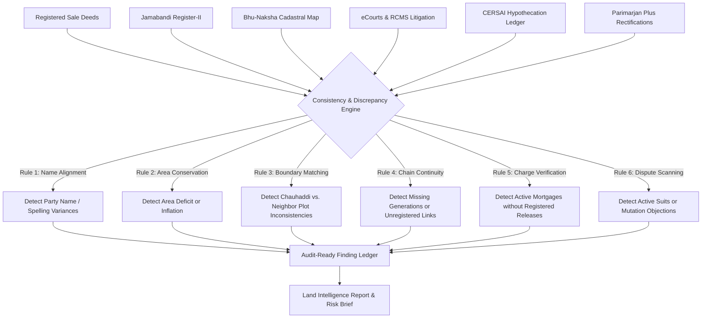

# 11 - Evidence and Risk Engine Specification

**Project:** Bhumi Setu  
**Document:** Technical Specification for Discrepancy Detection, Title Cross-Examination, and Explainable Risk Scoring  
**Date:** October 24, 2026  

---

## 1. Cross-Document Comparison Philosophy

Land due diligence is fundamentally an exercise in **cross-examining contradictory documents**. In Indian states like Bihar:
* The Registration Department (SRO) registers deeds based on party declarations without verifying actual physical possession or revenue updates.
* The Revenue Department (Circle Officer) maintains Jamabandi and collects land rent, but Jamabandis frequently lag behind registered deeds by years or contain transcription errors.
* The Survey Department (DLRS) draws cadastral boundary maps, which may reflect physical boundaries that contradict verbal deed descriptions (Chauhaddi).

Bhumi Setu's **Consistency Engine** (`backend/app/services/consistency_service.py`) automates this cross-examination across all assembled documents.



---

## 2. Discrepancy Taxonomy: 12 Core Detection Rules

| Code | Discrepancy Category | Severity | Detection Rule Logic | Required Next Step |
| :--- | :--- | :--- | :--- | :--- |
| **DISC-01** | `NAME_VARIANCE` | **Medium** | Extracted seller name on deed differs phonetically or lexically from recorded Jamabandi rayat name beyond Levenshtein distance threshold. | Require genealogical affidavit / voter ID comparison. |
| **DISC-02** | `AREA_DEFICIT` | **High** | Deed purports to transfer an area greater than the unencumbered area recorded in the seller's Jamabandi. | LandAmin field demarcation to re-verify physical holding. |
| **DISC-03** | `BROKEN_CHAIN` | **Critical** | Seller acquired title from Person B, but Person B has no recorded deed or mutation tracing back to original Khatiyan rayat. | Title search across SRO bahi-khatas for missing link deed. |
| **DISC-04** | `UNRELEASED_MORTGAGE` | **Critical** | An active mortgage / MODT appears on CERSAI or EC, but no registered deed of release / reconveyance exists. | Demand Bank NOC and formal redemption deed. |
| **DISC-05** | `BOUNDARY_MISMATCH` | **High** | Chauhaddi described in deed lists North boundary as a private owner, whereas Bhu-Naksha map shows North boundary as government canal/road. | Field survey to verify physical orientation and encroachments. |
| **DISC-06** | `PENDING_MUTATION_DISPUTE` | **High** | Active petition or objection lodged in Circle Court (RCMS) or Parimarjan Plus. | Obtain certified copy of Circle Officer proceedings. |
| **DISC-07** | `CEILING_OR_GOVT_LAND` | **Critical** | Plot number matches Bihar state gairmajarua aam (public communal) or gairmajarua khas (state forest/waste) schedule. | Immediate deal stoppage; title cannot be legally alienated. |
| **DISC-08** | `LITIGATION_ATTACHMENT` | **Critical** | Parcel or current owner identified in pending civil suit (partition, specific performance) or bank DRT proceeding. | Retain panel advocate to inspect suit plaint and stay status. |
| **DISC-09** | `UNREGISTERED_PARTITION` | **Medium** | Seller claims sole ownership of a specific plot portion based solely on informal family oral partition (Khangi Batwara). | Demand registered Partition Deed or signed Panchnama. |
| **DISC-10** | `LAGAN_DEFAULT` | **Low** | Land revenue rent unpaid for over 3 consecutive years on Bhulagan portal. | Verify and clear outstanding arrears and receipt. |
| **DISC-11** | `ROAD_WIDTH_VARIANCE` | **Medium** | Deed claims property abuts a 20-foot municipal road; master plan indicates an unpaved 8-foot village pathway. | Physical LandAmin site measurement. |
| **DISC-12** | `MISSING_CERTIFIED_COPY` | **Medium** | Historical deed referenced in title chain is available only as a photocopy, lacking SRO seal. | Dispatch SRO runner to obtain certified copy. |

---

## 3. Standard Finding Schema

Every finding returned by the engine adheres to an auditable JSON contract:

```json
{
  "finding_id": "find_7a81cd29",
  "property_id": "BR-PAT-DAN-KOT-KH48-PL112",
  "category": "AREA_DEFICIT",
  "severity": "HIGH",
  "title": "Deed Transfer Area Exceeds Jamabandi Recorded Balance",
  "description": "Sale deed draft proposes transfer of 10 Katha (1361.25 sqm), but Jamabandi Register-II (Jamabandi No. 412) records seller's total holding in Khesra 112 as only 7 Katha 10 Dhur (1020.94 sqm).",
  "discrepancy_delta": {
    "claimed_area_sqm": 1361.25,
    "recorded_area_sqm": 1020.94,
    "deficit_sqm": 340.31
  },
  "supporting_evidence": [
    {
      "document_id": "doc_deed_2024_draft",
      "document_type": "SALE_DEED_DRAFT",
      "cited_page": 2,
      "extracted_field": "transferred_area"
    }
  ],
  "conflicting_evidence": [
    {
      "document_id": "doc_jamabandi_412",
      "document_type": "JAMABANDI_PANJI2",
      "issuing_office": "Circle Office Danapur, Patna",
      "cited_page": 1,
      "extracted_field": "rakba"
    }
  ],
  "verification_status": "FLAGGED_FOR_LANDAMIN",
  "recommended_action": "Schedule LandAmin field measurement to survey physical boundaries and verify if co-sharers own the remaining 2.5 Katha.",
  "flagged_at": "2026-10-24T03:10:00Z"
}
```

---

## 4. Transparent, Explainable Risk Methodology

Bhumi Setu strictly rejects opaque, black-box AI risk scores (e.g. *"Risk Score: 78/100"* without justification). Instead, title risk is calculated through an **additive, categorized weighted matrix**:

1. **Category Weighting:**
   - Critical Issues (Government land, unreleased mortgages, active court stay): Automatic **HIGH RISK / STOP DEAL** flag.
   - High Issues (Area deficit, active mutation objections, boundary clashes): **PROVISIONAL / REQUIRES FIELD CLEARANCE**.
   - Medium Issues (Name variance, informal family partition): **REQUIRES DOCUMENTATION RECTIFICATION**.
   - Low Issues (Minor spelling difference, unpaid annual lagan): **ROUTINE ADMINISTRATIVE CLEARANCE**.
2. **Explicit Confidence Tagging:**
   - `VERIFIED FACT`: Supported by official certified government records.
   - `UNRESOLVED DISCREPANCY`: Direct mathematical or lexical contradiction between two verified documents.
   - `INFORMATION GAP`: Records before a given date are missing from digital archives and remain uninspected.
