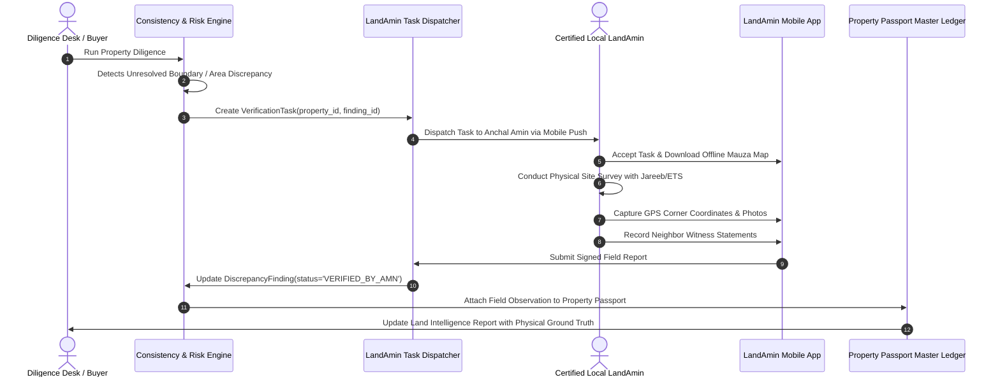

# 13 - LandAmin Field-Verification Operations Workflow

**Project:** Bhumi Setu  
**Document:** Technical Specification for Ground-Truth Field Verification and LandAmin Operations  
**Date:** October 24, 2026  

---

## 1. The Necessity of Ground Truth (The "Amin Advantage")

In Indian land administration, **digital records capture only what was reported to the government, not what actually exists on the ground**. A portal search cannot detect:
1. Physical encroachment over cadastral boundaries by neighboring plot owners.
2. Informal oral family partitions (*Khangi Batwara*) where co-sharers have divided plots on the ground without updating revenue Jamabandi records.
3. Adverse possession or physical occupation by unauthorized third parties.
4. Physical changes in land use (e.g. agricultural plot converted into an unapproved plotted residential colony).
5. Discrepancies between deed road width claims (e.g. "20 feet wide paved road") and ground reality (an unpaved 6-foot dirt pathway).

Landeed addresses this through its **LeX lounges and counter runners across 15 states**. Bhumi Setu formalizes this into an institutional **LandAmin Field Verification Network**, directly integrated with its existing `landamin-mcp` tooling.

---

## 2. End-to-End Field Verification Lifecycle

---

## 3. LandAmin Task Specification & Mobile Data Capture

### 3.1 Task Types
* `BOUNDARY_DEMARCATION`: Establish exact physical corner points of the Khesra using survey chains (Jareeb), electronic total stations (ETS), or RTK-GPS.
* `POSSESSION_VERIFICATION`: Determine who is in actual physical possession and cultivation of the land.
* `ACCESS_ROAD_VERIFICATION`: Measure exact access road width connecting the parcel to the nearest public highway.
* `SRO_RECORD_INSPECTION`: Inspect legacy physical deed bahi-khatas in the local Sub-Registrar Office for pre-digitization years.

### 3.2 Mobile Field Data Requirements
1. **Cryptographic Geotagging:** High-accuracy GPS coordinates (HDOP < 2.0) logged at every corner boundary.
2. **Watermarked Photography:** Site photographs showing:
   - Physical plot view from all four directions (North, South, East, West).
   - Permanent physical landmarks (wells, boundary trees, electric poles, masonry boundary pillars).
   - In-app camera injects immutable timestamp, latitude/longitude, and Property ID watermark onto the image raw pixels.
3. **Neighbor Statements:** Video or signed audio/written statement from adjoining plot owners confirming boundary peace and ownership continuity.

### 3.3 Integration with Existing Landamin MCP Tools
Bhumi Setu leverages the pre-configured `landamin-mcp` tools in this environment:
* `landamin_convert_land_units`: Converts local Bihar land units (Bigha, Katha, Dhur, Dhurki, Decimal, Kattha) accurately based on regional *Laggi* length variations (typically 4 to 8.25 Haath depending on the Bihar district).
* `landamin_bihar_survey_advisory`: Supplies statutory survey advice based on the Bihar Special Survey & Settlement Rules (बिहार विशेष सर्वेक्षण).
* `landamin_book_survey_appointment`: Schedules certified Amins and records appointment slots.
* `landamin_property_due_diligence`: Evaluates overall property integrity combining revenue and field data.

---

## 4. Role Boundaries: Field Observation vs. Legal Title

To maintain legal integrity, Bhumi Setu enforces strict separation between **physical field observations** and **legal conclusions**:

| Field Observation (Allowed for LandAmin) | Legal Conclusion (Reserved for Advocates) |
| :--- | :--- |
| *"Plot corners demarcated; physical area measured at 8.4 Katha against deed claim of 8.5 Katha."* | *"Seller has marketable legal title to convey the property."* |
| *"Adjoining neighbor on North confirms peaceful possession by Rameshwar Singh for 15 years."* | *"The land is free from all encumbrances and defect."* |
| *"No physical structure or boundary fence exists on the parcel."* | *"The transaction is compliant with Section 31 of Bihar Land Reforms Act."* |
